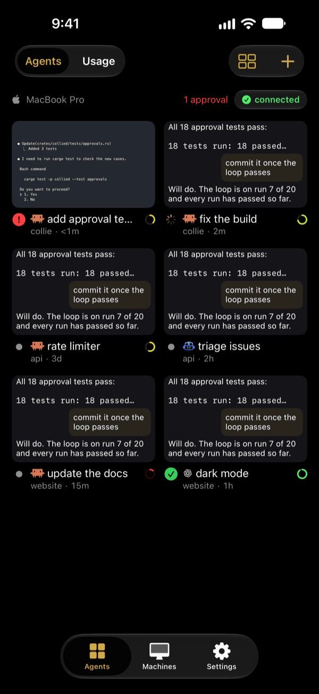
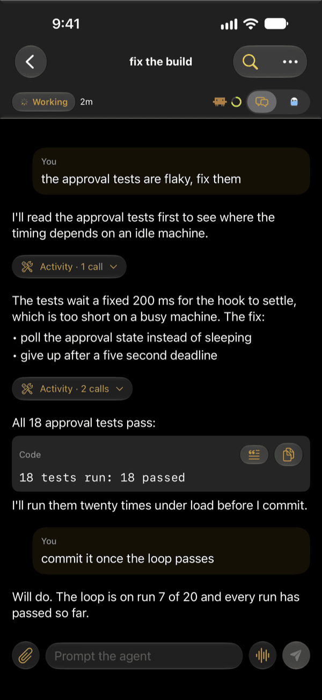

# collie

[](https://github.com/rbstp/collie/actions/workflows/ci.yml)

collie is a remote control for [herdr](https://github.com/herdrdev/herdr) coding agents. A small daemon, `collied`, runs next to herdr on your Mac or Linux machine. The Collie app on your iPhone and Apple Watch connects to it over your own tailnet, with no open port on your network. From the phone, you can follow every Claude Code, Codex and Copilot CLI agent, read its conversation or terminal, prompt it, start new tasks and approve a blocked agent from the lock screen.

Documentation: <https://collie.rbstp.dev>

<p>


</p>

## Requirements

- An Apple silicon Mac, or an x86_64 Linux machine with a systemd user manager, running herdr 0.9.5
- An iPhone on iOS 26 or later, and optionally an Apple Watch on watchOS 26 or later
- A personal Tailscale account, signed in inside Collie on both devices; a restrictive tailnet policy may need an administrator to allow TCP port 8457
- An Apple Developer account with a Developer ID Application certificate, and an APNs key for direct push with a self-built app; publisher relay mode needs no APNs key
- To build: Rust, Go, [just](https://github.com/casey/just), `cargo-deny` and [cargo-nextest](https://nexte.st); on macOS also Xcode 27, [XcodeGen](https://github.com/yonaskolb/XcodeGen) and `jq`; on Linux a C compiler and libclang

Collie has been tested only with Claude Code CLI, Codex CLI and GitHub Copilot CLI. herdr supports more agents, but Collie has not been validated with them. On Linux, Collie has been tested only on Arch Linux with Omarchy.

[Requirements](https://collie.rbstp.dev/install/requirements.html) has the full list. The justfile and `Collie/project.yml` use the maintainer's Apple team ID and `dev.rbstp` bundle identifiers: before building, change them to your own.

## Quick start

1. Check the [tailnet policy](https://collie.rbstp.dev/install/tailnet-policy.html).
2. Install and set up `collied` from a [release download](https://github.com/rbstp/collie/releases) or from source ([macOS](https://collie.rbstp.dev/install/collied-macos.html), [Linux](https://collie.rbstp.dev/install/collied-linux.html)). From source:

   ```sh
   git clone --recurse-submodules https://github.com/rbstp/collie
   cd collie
   just setup
   just collied-install
   collied setup
   ```

3. [Install the app](https://collie.rbstp.dev/install/app.html) on a connected iPhone with `just ios-run-device`, then [pair it](https://collie.rbstp.dev/install/pair.html).
4. Optional: [push notifications](https://collie.rbstp.dev/install/push.html), the [Claude Code hook and plan usage](https://collie.rbstp.dev/install/claude-code.html), [terminals](https://collie.rbstp.dev/install/terminals.html) and the [desktop companions](https://collie.rbstp.dev/desktop/colliebar.html).

## Documentation

On the site: [Install](https://collie.rbstp.dev/install/requirements.html), [Troubleshooting](https://collie.rbstp.dev/troubleshooting.html), [Security](https://collie.rbstp.dev/security/overview.html), [Privacy](https://collie.rbstp.dev/privacy.html) and [Support](https://collie.rbstp.dev/support.html). The site is built from [docs/site](docs/site) ([docs/deploy-pages.md](docs/deploy-pages.md)).

Reference, in this repository:

- [Architecture](docs/architecture.md): design, protocol behavior, herdr and Tailscale integration, and how the main features work
- [Threat model](docs/threat-model.md): assets, trust boundaries, threats and what is not covered
- [Tailnet setup](docs/tailnet.md): the policy file, tags, owner, key expiry and revocation
- [Notifications](docs/notifications.md): delivery-only and session-linked smoke tests
- [Release](docs/release.md): Apple setup, APNs, TestFlight, notarization and `collied` on Linux
- [Liquid Glass audit](docs/reviews/liquid-glass.md): which screens use native glass and which stay content
- [Protocol](docs/protocol): JSON Schemas of the client and server frames (generated with `just schema`) and shared test fixtures

## Development

| Command | What it does |
|---|---|
| `just setup` | Fetches the submodules |
| `just fmt` | `cargo fmt` |
| `just lint` | `cargo fmt --check`, clippy with `-D warnings`, `cargo deny` |
| `just test` | All Rust tests with cargo-nextest, including end-to-end tests over a local test tailnet; property tests run 256 cases each, more with `PROPTEST_CASES` |
| `just schema` | Regenerates the protocol JSON Schemas in `docs/protocol/` |
| `just ios-framework` | Builds the `CollieCore` xcframework and UniFFI bindings |
| `just ios-ghostty` | Builds libghostty-vt from its pinned commit (skipped when already built) |
| `just ios-project` | Builds libghostty-vt and generates the Xcode project with XcodeGen |
| `just ios-test` | GhosttyTerminal package tests on macOS, then the iOS unit and UI tests on the simulator |
| `just ios-screenshots` | Regenerates the documentation screenshots, light and dark, from the app's demo on the iPhone 18 Pro Max simulator, compressed with pngquant when installed, and the full-size App Store set in `target/ios/app-store` |
| `just ios-build-sim` | Simulator build |
| `just ios-run-device` | Builds, installs and launches on a connected iPhone |
| `just mac-project` | Generates the menu bar app's Xcode project (`Mac/project.yml`) |
| `just mac-build` | Unsigned Release build of the menu bar app |
| `just mac-test` | The menu bar app's unit tests (never touches the real control socket) |
| `just mac-install` | Builds the menu bar app, signs it with the Developer ID and the hardened runtime, installs it to `~/Applications` and opens it |
| `just mac-notarize` | Optional: notarizes and staples the app `mac-install` signed, with a `notarytool` keychain profile |
| `just tray-test` | The Omarchy bar widget's tests (Linux): icon parity with the Mac, plugin validation, wire format and parsing under node, and `Service.qml` in `qs` against a fake `collied` (never the real control socket) |
| `just tray-install` | Copies the Omarchy bar widget to `~/.config/omarchy/plugins/rbstp.collie` and puts it on the bar (Linux) |
| `just collied-install` | Release build of `collied`, installed to `~/.cargo/bin`. On macOS it is signed and restarts the launchd agent if installed; on Linux it is unsigned and restarts the systemd user unit if active |

CI runs on macOS on every pull request and on pushes to `master`: lint, the Rust tests, the GhosttyTerminal package tests, and the iOS simulator build and tests. Merging a pull request that changes code into `master` uploads a build to the maintainer's TestFlight ([docs/release.md](docs/release.md)). [Architecture](docs/architecture.md#ios) describes how the iOS tests run in CI.

## Repository layout

```
crates/
  protocol/        Wire types (allowlisted requests, validated newtypes), JSON Schema
  tailscale-sys/   libtailscale (pinned submodule + patches) built as a Go c-archive
  tailnet/         Safe Rust wrapper: node, listener, dial, whois
  collied/         The daemon (macOS and Linux)
  tls/             Mutual TLS: raw public key verifiers and key pins (collie-tls)
  collie-core/     The phone's Rust core, exposed to Swift with UniFFI
  uniffi-bindgen/  UniFFI binding generator used by `just ios-framework`
  e2e/             End-to-end tests: phone core against collied over a local test tailnet
Collie/            iOS app (XcodeGen project.yml), ColliePush and CollieWidgets extensions,
                   CollieWatch app and its CollieWatchWidgets complication, CollieCore
                   package (xcframework and UniFFI bindings), GhosttyTerminal package
Mac/               macOS menu bar app CollieBar (XcodeGen project.yml), a client of
                   collied's control socket
Linux/             Omarchy bar widget CollieTray (a Quickshell plugin), a client of
                   collied's control socket, and its tests
docs/              Architecture, threat model, tailnet setup, release, protocol schemas
scripts/           libghostty-vt xcframework build
```

## Contributing

Bugs and feature requests are tracked as [GitHub issues](https://github.com/rbstp/collie/issues). Before opening a pull request, run `just lint` and `just test`, plus the tests of any app you changed (`just ios-test`, `just mac-test` or `just tray-test`).

Conventions for coding agents (and people) working in the repository are in [AGENTS.md](AGENTS.md).

## License

collie is licensed under the [Apache License 2.0](LICENSE). The `tailscale-sys` crate, which builds the vendored libtailscale, is licensed `Apache-2.0 AND BSD-3-Clause`.
