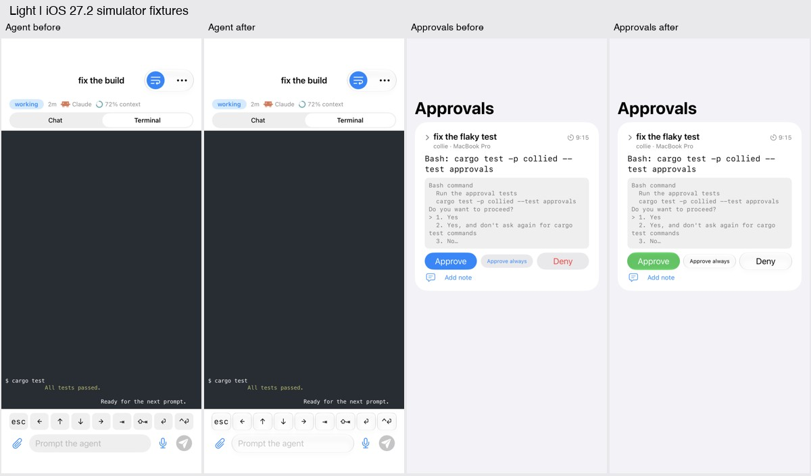
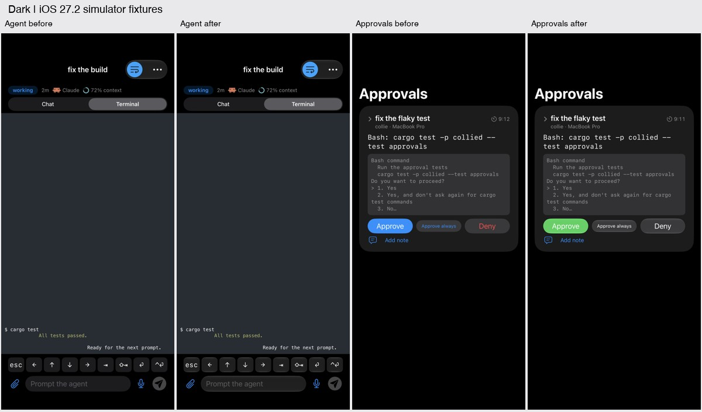
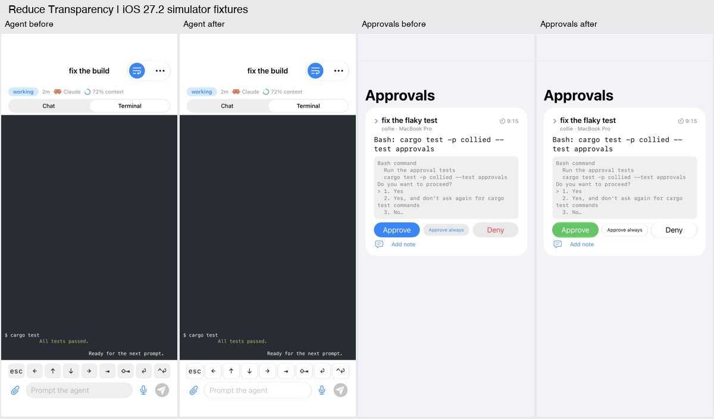
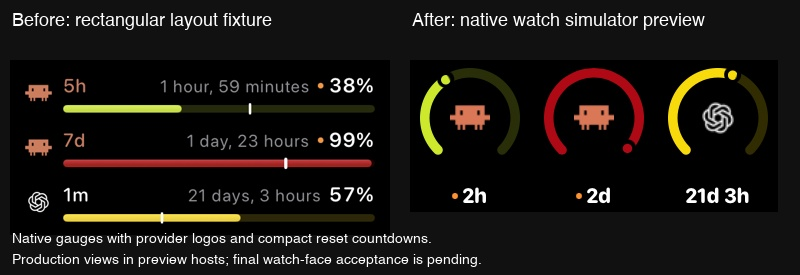
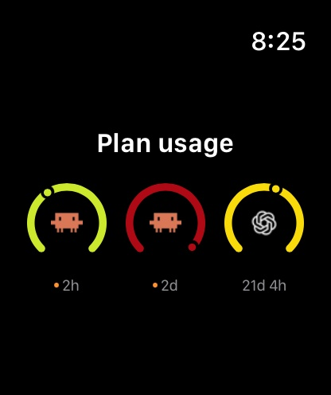
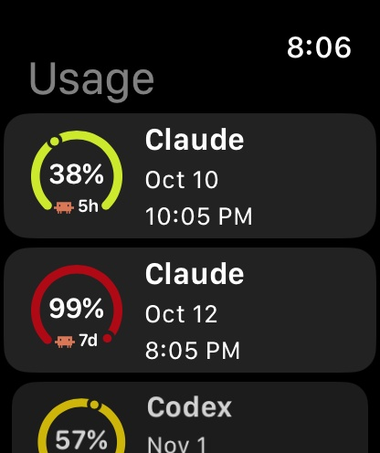
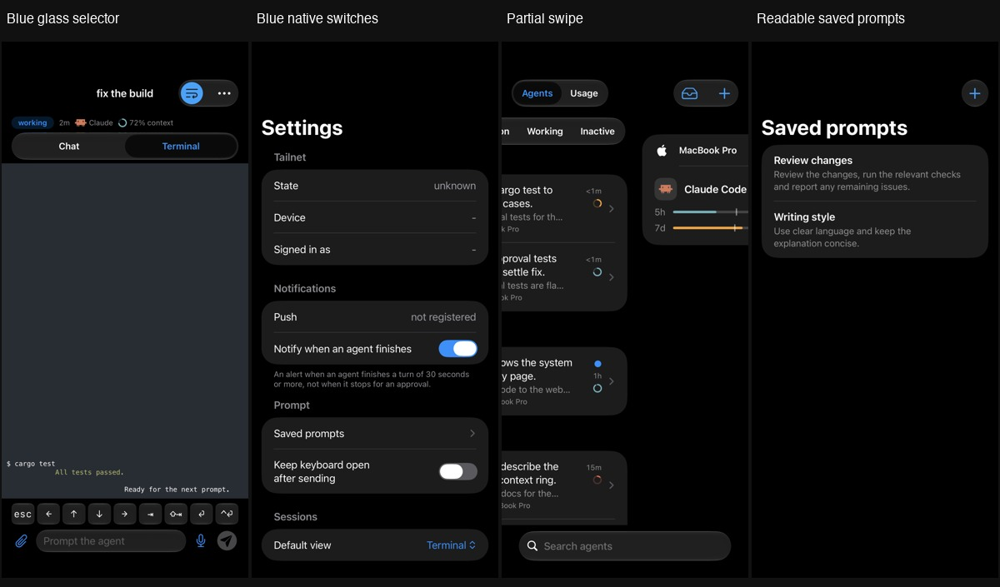
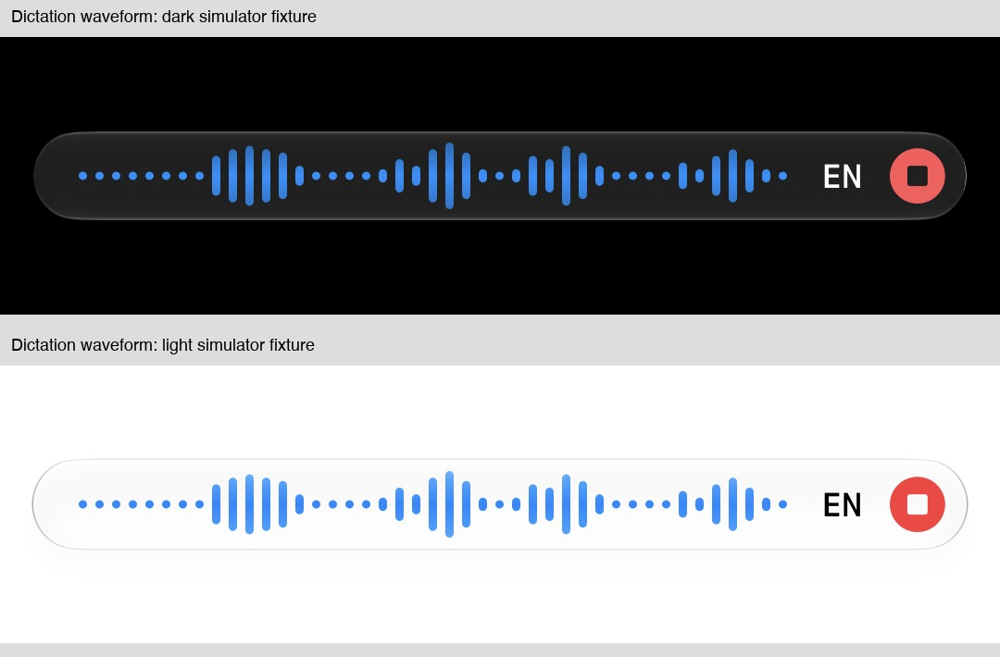

# Liquid Glass audit

Issue #207 uses the iOS 26 and watchOS 26 glass APIs directly, with minimum versions at 26. System navigation, toolbars, sheets, menus, pickers and search keep native styling. Prioritize dark mode, keeping native appearance and accessibility; glass uses the system material and respects the user's glass setting.

The app caps Dynamic Type at AccessibilityXL (`.dynamicTypeSize(...DynamicTypeSize.accessibility3)` at the root): every screen is checked to fit at that size on the iPhone 18 Pro Max, portrait and landscape, and the two larger accessibility sizes are not supported.

- **Agent inbox:** segmented filters in a top inset the rows scroll under, across the full width, so all five fit on the iPhone 18 Pro Max and scroll only on narrower phones or with larger text. Search is a button in the toolbar capsule beside Layout and New task; it replaces the filters with the search field on its own glass and a close button, and leaves the capsule while the field is open, so one control ends search. The field's placeholder is in the metadata gray, as in New task (4.97:1 in light mode, 7.4:1 in dark; the system's placeholder gray measured 1.74:1 in light mode). A filter shows its one group without a section header, as the selected filter already names it, the first row 24 points under the filters. The filters and the search field hold still: pulling the rows or the empty state refreshes, with the spinner under them, and a drag on the filter row moves nothing. Each Agents page takes its own refresh, the inbox's on its list alone; on the pager it also reached the filter row's horizontal scroll view, whose refresh control let a drag beside the filters pull the row down out of sight. Rows, state badges and unread indicators stay content.
- **Agent grid:** cards stay content, as terminal previews need a stable background. A chat preview's text sits 10 points from its panel's sides, closer to the terminal preview's inset than the 6 points it had, and 6 from the top and bottom, so the 84-point preview still fits a bubble and three lines. A terminal preview sits on the same inset panel as a chat preview, the tertiary fill over the card (239,239,240 in light mode, 50,50,54 in dark), drawn by the terminal as its background, so light text keeps its 4.5:1 floor against the panel (default text 9.9:1, dark mode white 12.8:1): the light terminal's own #FAFAFA measured 1.02:1 on the white card and lost the panel, and dark's blue-gray #282C34 clashed with the neutral chat panels. The session terminal keeps its theme; context menus use system styling. A preview's running subagents overlay is clear glass over the composer's dark dimming color, always dark, with white text.
- **Every Agents page** (grid, list, inbox, Usage): navigation and tab bars keep system glass with no scroll edge effect or glass behind them, leaving only the picker, buttons and tab bar, each on its own glass. On Usage the capsule keeps only New task: Layout and Search hide rather than sit dimmed (2.1:1 to 2.3:1). Content runs under the tab bar at full clarity; under the top bar it fades into the page background across the status bar band, because the native top edge effect follows the pager, not each page's own scroll view, and left content readable behind the clock.
- **Approvals:** glass on decision buttons, green for Approve and a red label for Deny; commands, notes and question choices stay content.
- **Conversation:** glass on search, copy and navigation actions and on the activity and wake rows, never accent: tool names, wake lines and Copy are primary, icons, call counts (from two calls) and chevrons in the metadata gray (secondary gray measured 2.9:1 on this glass over a light chat); messages and code stay content, code blocks on the same tertiary fill as your message bubbles, in subheadline monospaced, as are inline code and the file paths in it (at body size, and even a step down at callout, its larger x-height outsized the prose), so code never outsizes body text. A code block's Copy turns into a green check mark (Copied) for three seconds, like the connection error's copy button. Your messages sit in neutral fill bubbles that hug short text at the trailing edge. A conversation shorter than the screen starts under the header, the same gap above it as a longer one has, rather than sitting low above the composer.
- **Git changes / diff review:** glass from #205, unchanged.
- **New task:** the prompt field is plain form content, with glass only on the attachment, upload, dictation and hide-keyboard controls; folder choices and task settings stay form content.
- **Saved prompts / editor:** plain row buttons (no blue tint dimming prompt text) and larger previews; rows and editor stay content.
- **Plan usage:** content, two cards under each machine's name: plan usage, then tokens and cost; bars, figures and reset times need stable backgrounds. With one machine paired the name goes, as on Agents, and each stale reading's own "Updated" line says its age.
- **Machines / machine settings / pairing:** system forms; machine details stay content. A machine's link status is plain text with its symbol, not a glass pill inside the row; on Agents, a connected machine shows no link status, and other link states keep their pill. With one machine paired, the grid's and the list's section header drops the machine's name, as the inbox rows do, and keeps only the approvals pill, a link state pill and a link message; with none of them the section has no header. The header retries the machine on a tap only when it names the machine or the link is not connected: on a connected machine a retry shows nothing, and the lone approvals pill, a red glass capsule, read as a way to the approval. With larger text, the pills drop under the machine's name rather than break it mid-word.
- **QR scanner:** system scanner UI and a native Cancel toolbar item.
- **Settings / gestures:** system switches and a selectable accent color; diagnostic values stay list content.
- **Onboarding:** glass on sign-in and auth-key actions; instructions and input stay form content.
- **Watch app and widgets:** native `List`, `NavigationLink` and `Gauge` throughout, none needing replacement; agent status, commands and approval status stay content. Approve uses `.glassProminent`, Deny and question actions `.glass`.
- **Watch usage detail:** compact native list of logo gauges, window labels, percentages and reset countdowns; tapping a window shows its countdown, reading age and elapsed percentage; no glass on content.
- **Watch complications / Smart Stack:** the rectangular widget shows three native `.accessoryCircular` gauges, provider inside and bold reset countdown below; no window labels, for gauge space (the app shows percentages after a tap). A value-based tint dims the unused arc but keeps the native usage marker; the circular complication keeps elapsed-time ticks. Preserve stale and missing-data states. Gauges use `widgetAccentable` and no extra glass.
- **Live Activity / Dynamic Island:** system-hosted; no forced black background, white system actions or dark appearance on the Lock Screen. Status pills stay content; approval buttons keep the native widget style.

## Agent session

- The bold inline title wraps to two lines, cut without an ellipsis. The bar caps it at 19 points; at accessibility sizes in portrait, where that left it smaller than the status row under it, it leaves the bar and leads the header instead, above the status row, at title 3 size growing with the text (subheadline and headline came out about as large as the status row's caption). While approval cards show it stays in the bar: in the header its lines left the command and the reason no room above the decisions.
- The header (under the navigation bar, with the subagent list) is full-width, edge-to-edge regular glass, with content running under it and no scroll edge effect under the navigation bar, so it reads as one glass area. Regular, not clear: clear glass over a dimming layer still let busy terminal text read through the title, status bar and controls; regular glass blurs it. Its bottom feathers out over 8 points at the default text size, growing with the text (a fixed 8 points cut large text running under it in half), instead of ending on a hard cut, and the glass rim, which drew a hairline seam there, lies past the mask. In light mode a faint gray tint (4% black) over the glass gives it a visible lower edge: untinted, light glass over a white chat measured #FCFCFC, so chat text seemed to run straight into Deny.
- The status row leads with the state icon and elapsed time, then the machine name in secondary caption, which truncates first. The state is its bare 20-point icon, as in list and inbox rows (the spinner while working, the green check when done, the red disc when blocked), read as the status word: the word took the machine name's room, and the icon already says it. It has no glass circle: in one it read as a button, unlike the bare icons on grid cards, list and inbox rows. Without the circle's dim, idle's dashed ring keeps its full gray rather than the rows' 75%, which read 2.4:1 over the dark terminal; on the header glass over the terminal the icons measure 3.7:1 (working), 4.0:1 (blocked), 4.6:1 (done) and 3.0:1 (idle) in dark mode and 5.3:1, 5.4:1, 5.0:1 and 4.7:1 in light mode, more over Chat. While approval cards show, the elapsed time hides, as the card's countdown is the time that matters then. A machine's pills keep their text, the approval count and an offline link's state, which an icon alone would lose. The pull request badge, provider, context (as on grid cards, list and inbox rows, only once less than 70% is left: a figure on every agent was noise) and the Chat/Terminal switch group on the trailing side. Its text grows with Dynamic Type only up to xxxLarge, so at accessibility sizes it keeps one row under the title rather than pushing the screen past both edges or splitting in two (title and two status rows took 29% of the Pro Max screen); it splits, the state, time and machine above the badge, provider and context, only when even that does not fit, as with a pull request badge on a narrow phone. The machine name gives way first and never splits the row. All other header text, subagent time and tokens included, uses the primary color.
- The terminal follows the appearance, and the header, composer controls and navigation bar over it follow it too. Dark keeps the One Dark background (#282C34) and white text with libghostty's palette. Light is One Light's background (#FAFAFA) and text (#383A42, 10.9:1) with its own 16 ANSI colors, each 4.8:1 or more on that background; 256-color and truecolor text stays as sent. Agents color text for the Mac's terminal, usually dark (Claude Code's secondary gray 153,153,153 measured 2.7:1 on the light background, Codex's light text 1.2:1), so in light mode any glyph under 4.5:1 against its cell moves toward black, or toward white on a dark band such as Claude Code's sent prompt, just far enough to reach 4.5:1, keeping its hue; faint text is first blended halfway into its cell, then held to the same floor. The default text on such a band draws white, as the agent meant it: raised only to 4.5:1 it read as a dim placeholder. Text drawn in its cell's own color stays hidden. Selection keeps the accent at 35%; agents draw their own cursor as reversed cells, which take the theme's colors.
- The prompt field's placeholder (Prompt the agent, Type an answer) is in the metadata gray, as in New task: the system's placeholder gray measured 1.8:1 in light mode and 2.4:1 in dark.
- The composer has no band; content shows around its glass controls. The exception is Terminal while its keyboard is up: the terminal then keeps Claude Code's input box just above the composer, which puts the rows under the box (the model line, background agents) behind the key strip and the composer, where they showed between and through the controls. There the strip and the composer sit on the terminal's own background, which hides those rows as the terminal's end would; it has no feather, as the box's bottom rule ends at its edge and an 8-point feather showed the top half of the row under it. Its notice, error, retry and dictation problem lines each get their own regular glass, and each such control and line has a dimming color behind its glass (70% black in dark mode, 80% white in light), in its own shape (small glass alone left busy content hard to read in dark mode).
- Terminal text starts 16 points from the sides, the gutter of the header, the cards and the composer, in portrait and landscape: the canvas's own 8-point inset plus 8 points of horizontal content inset on the session terminal (it started at 8, out of line with the chrome). Grid previews keep the canvas's 8 on their small panels.
- The blocked hint and Continue in Terminal above the composer both sit at the leading edge. In Chat, Continue in Terminal replaces the hint, which said the same.
- Attachment content sits outside the glass composer; the lock notice stays content.
- In the Terminal view the composer has no prompt field, as the keyboard types into the terminal: one row of 38-point glass circles over the dimming color, the paperclip (agents other than a plain terminal) and the keys toggle on the left, dictation and the keyboard toggle on the right, under the key strip. The keys toggle is a command key (`command`, in the accent when on), as in Rex's key bar: not the arrow keys the joystick beside it already shows, nor a keyboard like the keyboard toggle. Every glyph in these circles is 20 points, the joystick's and dictation's size and Chat's hide-keyboard (the keys toggle was 16, the keyboard toggle and Return 18), except the paperclip at 17: its diagonal at 20 ran 24 by 27 points against the others' 18 to 21 points tall and filled its circle, and at 16 its strokes read thinner; at 17 it measures 20 by 23 and matches their weight. The paperclip stays: a file's machine path and a saved prompt are typed into the terminal. With the strip hidden, the cursor joystick joins the row as a 38-point circle before the keyboard toggle, with a 44-point touch target past it, so the arrows need no strip and the row keeps its height; on the right it stays near the strip's trailing joystick, which replaces it when the strip shows, so there is never a second one. A Return circle (`return`, primary) follows the keyboard toggle on the same terms, so dictated text can be submitted without the keyboard or the strip: last in the row, where the right thumb rests and where Chat puts send, after the keyboard toggle as Chat's hide-keyboard sits before send. With the strip shown, the strip's return replaces it.

## In-session approvals

- The cards form a full-width, edge-to-edge band at the bottom of the session header, sharing its one regular glass (two edge-to-edge glass layers show a seam). Like the header, it follows the appearance. Under the band's feathered edge, Chat and the terminal fade into their own background over three times the feather (solid for its first 40%): the band is taller than the header alone, and a line of chat crossing its edge read cut in half, blurred above and sharp below.
- Text follows Dynamic Type up to the app's cap, in compact footnote and caption styles with 36-point decision buttons, as in the approved mockup. Decision labels never shrink: when one row would cut a label, Approve takes a row of its own above Always allow and Deny, and when two rows would, all three stack; each is judged at the equal widths a row gives its buttons, with 8 points of room on each side of the widest label. Approve's label is semibold, on prominent glass in a deeper green than the system's, so its white label keeps 4.5:1 in both appearances; the equal widths are measured at semibold. Always allow (shorter than the former Approve always, which nearly filled its third of the row) is neutral glass with a regular primary label, Deny glass with a regular label in the Blocked red, the deeper red in light mode, as system red falls under 4.5:1 there. Both have the dimming color behind their glass: over the terminal the glass came out lighter than over Chat, and Deny's red read 3.1:1 on it. Review has the same dimming color behind its glass, so in dark mode the card's buttons read as one surface: without it Review came out a lighter pill (84,90,100 over the terminal against the decisions' 58,60,64; now 56,58,62) and its orange shield read 3.2:1 there. The shield now reads 5.1:1 over the dark terminal, 6.0:1 over dark Chat and 5.1:1 in light mode, the label 11.4:1, 13.8:1 and 20:1.
- A card's header is the tool's name (Bash), the countdown and Review, as on the band; the session header above already names the agent and machine. The command sits in its own nested panel in primary footnote monospaced text, readable at rest without scrolling: it wraps at spaces only, never after a hyphen, so a flag such as `--nocapture` stays whole, and a bare `--` stays with the argument after it. On the card it shows up to three lines; VoiceOver and the sheet read the whole command. The card leaves the output to the review sheet, as its first three lines took room from the conversation and seldom decided the answer. Review is the one way into the sheet, with one label and one style on the card and the band: round 9 opened it from the tool's name with a chevron and from Show full command, and round 10 from Review on the band, an output link (Output, 8 lines) on the card or, without output, Show full command, three looks for one sheet. In the sheet the output uses the primary color at 60%, 5.3:1 on its panel in light mode and 5.5:1 in dark, where secondary gray and even the metadata gray (4.2:1) fell short. Add note is in the review sheet only, so a note takes Review, then Add note: once the sheet held it with the decisions, the card's copy sat alone in a mostly empty row.
- Nested panels (command, output, reason, question choices) use a 12-point radius.
- While cards show, the composer drops its blocked hint, which the cards already answer, and Chat drops Continue in Terminal unless every card must be answered in the terminal.
- Known limitation: in Chat, VoiceOver touch exploration under the header and the band lands on the conversation, so VoiceOver reaches Approve, Deny and the header's controls only by swiping.
- The cards take under half the whole screen's height, keyboard or not (45%, a quarter in landscape), and never more than the session header and the composer leave them. A card shows whole when it fits its share, as at the default text size in portrait; it never scrolls, so nothing sits cut under a fade.
- A card that does not fit (landscape, larger text) is a band: the tool's name, its command on one line, the countdown and Review, with the decisions under them when they fit too. In portrait the command shares the tool's row when it fits there whole and takes a row of its own, cut to a line, when it does not; in landscape it always shares the row, cut to fit, as two rows left the decisions no room. Review, here and on the card, is neutral glass with a semibold primary label and, when the agent gave a reason, the shield in the warning orange. Its label reads 10.7:1 over dark Chat, 7.0:1 over the dark terminal and 19:1 in light mode, and the shield 4.9:1, 3.2:1 and 5.0:1. Its 30-point glass takes taps over a 44-point shape, so the row keeps its height; where that shape reaches the band's decisions, they sit in front and take the tap.
- Review sheet: Review opens the whole prompt in the native sheet (glass at half height, larger on a drag; full height at accessibility sizes, where half left the stacked decisions no room for the reason), titled with the tool's name, with Close and, in the last 2 minutes and above half height, the countdown in its bar (at half height the card's countdown shows just above). The half-height detent is as tall as the sheet's content, measured, and never taller than the medium detent: at medium, a short output left about 150 points of the sheet empty. The task's title (subheadline, regular weight, so it reads under the tool's name rather than as a second heading) and, when more than one machine is paired (the inbox rows' rule), its machine under it (caption, the primary color at 60%: the metadata gray read 4.2:1 on the half-height sheet's light glass) head the prompt: at full height the sheet hides the session header, and two tasks can ask for the same command. At half height (in portrait, below accessibility sizes) the sheet never shows the task, which the dimmed session header above shows, and leaves to the dimmed card what it shows whole, giving the output the room: it shows the command only when the card cuts it (after three lines, or to one line on a band; the card measures its command's text without the line limit and tells the sheet), and the reason only when the card leaves it out (a band). Round 14 kept all three whenever the card cut either, which left a long command's output 5 of its 8 lines. Full height, landscape and the keyboard (which lifts the sheet over the card) show them all. The approvals notice (not authenticated, a transport error, a decision sent but not confirmed) shows above the decisions too, as the band's copy sits behind the sheet; while the sheet is open that copy hides, as it peeked above the half-height sheet cut through its letters. A notice shows only in the task, and in the sheet of the approval, it reports on: the app shares one approvals model, and one task's failure used to show on every other task's band and sheet. In both it is styled as the session's notice line, the warning orange with a triangle on its own glass over the dimming color; a notice about a pending approval stays until the next decision, whatever other approvals arrive, change or leave meanwhile, and once that approval leaves it lasts six seconds. The whole command, the reason, the whole output and the question's choices scroll above Add note (or the note's field), Approve, Always allow and Deny, which sit pinned under the scroll view rather than in a bar over it: over the prompt, a soft scroll edge let it read through the decisions' glass, and even a hard edge left a ghost of an output row under the notice in landscape light mode. Add note sits with the decisions, as a note goes with the decision; at the end of the scroll view, the half-height sheet cut its row in half. Add note shows the note's field focused, with the keyboard up, as Name workspace does in New task, so a note takes one tap rather than two; the field and the decisions stay above the keyboard at half height, full height and in landscape. The field, like the answer field of a prompt that takes one, has the command and output panels' look (the tertiary fill, a 12-point corner radius, 8 and 10 points of padding): the rounded border style drew a black box on the dark sheet, the app's only one. Its placeholder is in the metadata gray, as in Chat and New task (6.2:1 on the panel fill in dark mode, 4.6:1 in light): the system's placeholder gray read 2.2:1 and 1.7:1, and the field looked disabled. In landscape it leads the decisions' row until its field opens, as a row of its own, with the notice, left the output two lines; at accessibility sizes it keeps its own row. It is a label with a leading `text.bubble` symbol in the accent and a 46-point tap target that reaches into the gaps around its row, so the row stays compact: the half-height sheet draws at 96%, where 44 points measured 42.2. Its label uses the primary color at 75%, with only the symbol in the accent: on the band's glass over the dark terminal, where it used to sit, the primary color at 60% read 4.2:1 and the gold accent 3.8:1. In the sheet its label reads 9.6:1 in dark mode and 9.1:1 in light, its symbol 6.5:1 and 4.9:1. Closing the sheet closes the note's field and keeps its text: the card has no field, and a note left open would have gone, unseen, with a decision there. When the prompt runs past the scroll view's bottom edge (landscape, long output), a 24-point fade on that edge, inside the scroll view and never over the decisions, says more follows; it goes once the end is in view. The session presents it, not the band, so it follows the appearance over the terminal; an answer or the approval ending closes it. Rounds 5 and 6 instead fitted the card by measured line heights, hid the reason, Add note and output in turn and let the decisions scroll with the prompt in landscape, which still left landscape at accessibility sizes with no decisions in view.
- The countdown pill shows only in the approval's last 2 minutes: earlier the time left is no call to act, and the title row is the tool's name and Review. It is in the metadata gray, then blocked red in its last minute, on its glass with the dimming color behind it, as Review and the decisions have it: with the dimming color over the glass the pill came out darker than Review beside it. The glass alone read 3.7:1 over the dark terminal. The last minute's red reads 4.9:1 on the card over the dark terminal, 4.6:1 on the landscape band there, 5.9:1 over dark Chat and 5.7:1 to 5.9:1 in light mode; in the sheet's bar, where it shows only above half height, the gray reads 5.7:1 in dark mode and 5.0:1 in light. It shares Review's footnote semibold (monospaced digits) and, on the card and the band, the height of Review's glass: in caption2 it was a 21-point pill beside a 30-point button, which read as two kinds of control. The agent's reason sits under the command with a shield symbol in the warning orange, inside an orange rim (40%): in light mode on a faint orange fill (10%), as a fill-only panel looked like a different component; in dark mode on the command panel's neutral fill, as even 6% orange read warm brown over dark glass.

## Controls

- **Glass placement.** Glass covers the composer, terminal keys, jump and notice actions, upload and dictation controls, attachment removal and the unlock action. Attachments, dictation, send, keyboard dismissal and attachment removal use native glass button styles. The key strip's main keys (ctrl, shift, esc, tab, delete, return) share one 44-point interactive glass capsule over the dimming color, as in Ghostty's key bar: plain buttons in equal cells with hairline dividers, no glass per key. Labels are 22-point SF Symbols at any text size, as in Rex's key bar: `control`, `shift`, `escape`, `arrow.right.to.line`, `delete.left` and `return`. Large glyphs read at a glance where the earlier callout words (ctrl, shift, esc, tab) looked small in 44-point cells, and fixed sizes keep six cells in the row at accessibility sizes. A selected modifier takes the accent, on a faint accent fill so it stays visible with the None accent. The four arrow keys are gone: the cursor joystick, a 44-point interactive glass circle that is also its touch target, ends the capsule's row, with a primary d-pad glyph at rest and an accent sector toward the arrow it sends while dragged. Combinations, saved shortcuts and **+** sit in a second, scrolling row of 30-point glass capsules, the same shape as the main keys' capsule and the round controls. Combinations show 20-point symbols, as large as the 30-point capsule allows, a modifier's first (`shift` then `arrow.right.to.line`; `control` then the letter, which has no symbol), as does a saved key shortcut without a name; a name or text stays in callout medium, and only a saved shortcut that shows the text it types is monospaced. Each chip's touch target is 44 points tall, reaching into the gaps above and below it, which the row's spacing gives up so the strip keeps its height. Chips with a name or text grow with text size up to xxxLarge. shift-left shows only in Codex sessions, the one agent that takes it, rather than sitting dimmed elsewhere. Adjacent custom glass controls share `GlassEffectContainer`; nothing inside a glass composer or dictation capsule adds more glass.
- **Accent buttons.** Prominent buttons in the accent (Start, send, Jump to bottom, notice options, Unlock, Send feedback, Sign in) take a black label when the accent fill is light, where white falls under 3:1: None and Dark Gold in dark mode (white measured 2.5:1 on Dark Gold), orange and green in both appearances. Blue, red and the light Dark Gold keep white. Disabled, they keep the system's label, as the fill turns gray (black on it read 1.9:1 in dark mode).
- **Warning orange.** Orange notice text and glyphs (the session's link error and blocked hint, Chat's load error, an unreachable machine, a machine's version mismatch, a failed close and a failed move on Agents, the reason's shield) share one color: system orange in dark mode; in light mode, where system orange read 2.3:1 on light backgrounds and even its high-contrast variant (197,83,0) 4.33:1 on the blocked hint's glass, a deeper orange of the same hue (180,75,0); the context and usage limits' orange is the same.
- **Status pills and copy buttons.** App status pills (connection, approval count) and the connection error and prompt copy buttons use regular glass without a dark fill; the approval countdown puts the dimming color behind its glass, as Review does (below). On the approval band and machine rows, they and the band's decision buttons sit glass on glass.
- **Attachment button.** Its native menu stays stable while open and presents Saved prompts, Files or Photo Library after it dismisses. Its 17-point paperclip (see the Terminal composer above) uses the primary color, like the keys, idle dictation and hide-keyboard glyphs: in the composer the accent marks only send, the keys toggle when on and active dictation. Its glass circle matches the 38-point dictation, keyboard and send circles; its 44-point hit target extends past it, as theirs do. Glyphs in these circles, send included, have fixed point sizes, so they stay inside their circles at any text size. Pickers open locally, not waiting for the machine; the upload chip distinguishes preparing, waiting for the machine and uploading.
- **Wrap lines.** A toolbar button, not a button-style toggle, on the shared glass capsule; its icon is accent when on and primary when off, like other glass toolbar icons, and its title carries the state (Wrap lines on or off), as bar buttons pass only their title to accessibility.
- **Segmented controls** (Agents/Usage, inbox filters, Usage costs range, Chat/Terminal). Native, with semibold labels, accent-colored selected text and the system's sliding glass selection, never a forced black or white segment. In dark mode a picker in content (inbox filters, Usage costs range, Chat/Terminal) draws a lighter gray selection lens, where the gold label measured 2.2:1, so its selected label is white instead (6.9:1 on the filters, 5.5:1 on the range, and Chat/Terminal's icons 5.2:1 over Chat and 4.1:1 over the terminal); Agents/Usage in the toolbar keeps a dark lens and the accent (gold 8.6:1), as does every picker in light mode (gold 6.1:1). UIKit leaves a tapped toolbar control's selected label in its pressed tint, so once the press lens settles the control is re-added to its window, restoring the accent and keeping its frame. Dropping UIKit's one-point bottom alignment inset, which the controls draw over, makes Agents/Usage match the capsule beside it in height.
- **Chat/Terminal.** Compact and icon-only (speech bubble, terminal symbol, one SF Symbol language) at the right of the session header, with 44-point segments and VoiceOver labels Chat and Terminal. No glass backing: extra glass beside other glass left keyboard animations unfinished after a picker closed.
- **Agents/Usage paging.** Native interactive page scrolling reveals Usage progressively during a drag rather than switching on release; selector-triggered transitions respect Reduce Motion.
- **Dictation waveform.** An accent-colored translucent gradient, solid with Reduce Transparency or Increase Contrast, fills the capsule width with recent microphone levels (silence and repeats included) on a more sensitive scale; its history clears when dictation stops or switches language.

Reference: [Apple's Liquid Glass guidance](https://developer.apple.com/documentation/swiftui/applying-liquid-glass-to-custom-views).

## Validation

- `just ios-test`: passed (274 app tests, 62 Ghostty tests).
- `just lint`: passed. The later Codex prompt reflow change also passed all 334 `collied` tests, targeted Clippy and formatting; its regression test fails before the fix and passes after.
- Signed iPhone build, embedded watch app and widgets: built and passed signature verification.
- Diff review covered approval guards, disabled states, composer behavior and widget missing and stale states; visual review fixed clipped terminal key labels. Physical watch feedback exposed a widget-only collapse in the geometry-scaled gauges, fixed by removing that transform and sharing the plain native gauge with usage detail.
- Simulator fixtures covered light, dark, Increase Contrast, accessibility text sizes, actual Reduce Transparency, and native paging at a partial offset (both pages visible) and settled on Usage. Approval actions stack at accessibility sizes. Existing agent header and key clipping at extreme text sizes is out of scope.
- Dictation fixtures cover dark and light, a narrow bar and accessibility text with Increase Contrast; session tests verify speech and silence history, its size bound, and clearing on stop, cancellation and language change. The user accepted the latest phone build after the microphone sensitivity adjustment.
- Native watch simulator previews and rectangular fixtures cover reset countdowns and missing data. Standalone previews missed the physical widget layout failure; physical feedback confirmed the fix and approved the compact usage list. The user accepted the final refinements (dimmed unused arc, bold countdowns) on the physical watch.

Screenshots render deterministic fixtures with production views; the watch simulator image hosts the production gauge view in a temporary app, not a configured watch face.

| Light | Dark | Reduce Transparency |
| --- | --- | --- |
|  |  |  |

The latest signed build was installed and launched on the physical iPhone. The signed Mac companion, with the Codex-only prompt reflow fix, was updated and restarted, and status and doctor checks passed. Physical photos confirmed the watch update transferred and the Plan Usage layout was accepted. The user authorized auto-merge. Still manual, as Simulator fixtures cannot validate these system-hosted presentations: iOS 27 glass setting extremes, Live Activity clear and tinted Lock Screen styles, actual watch face accenting and physical watch readability.
