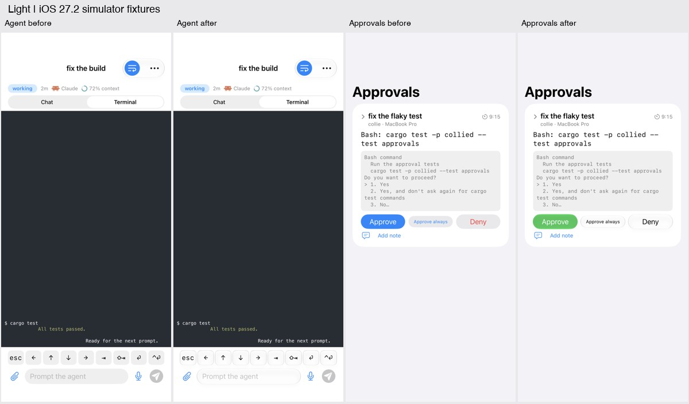
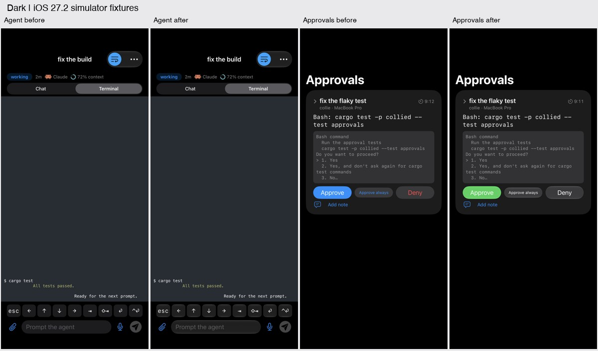
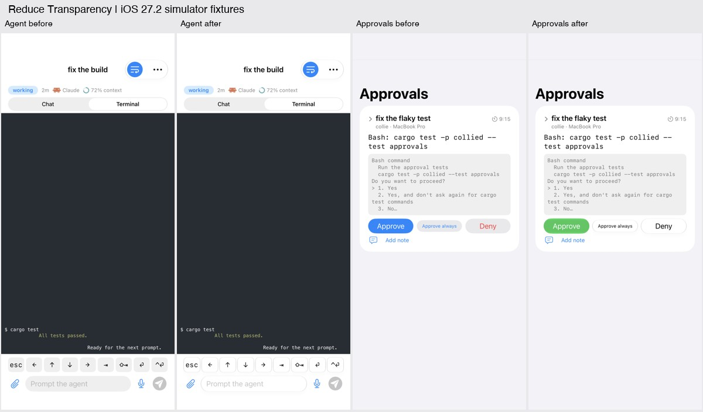
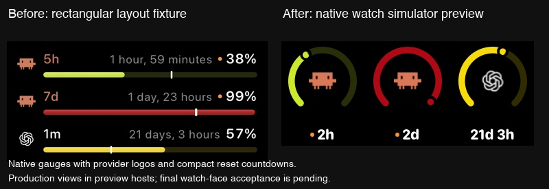
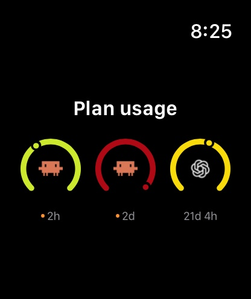
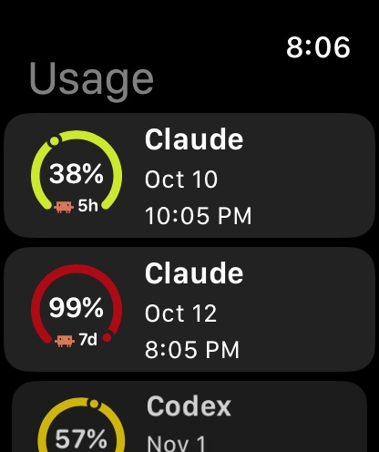
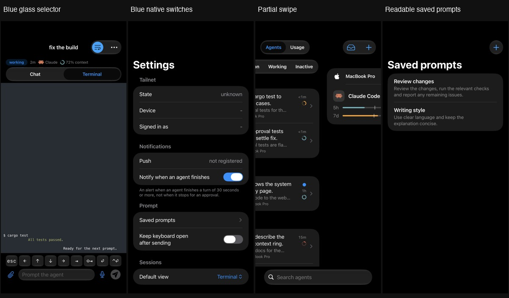
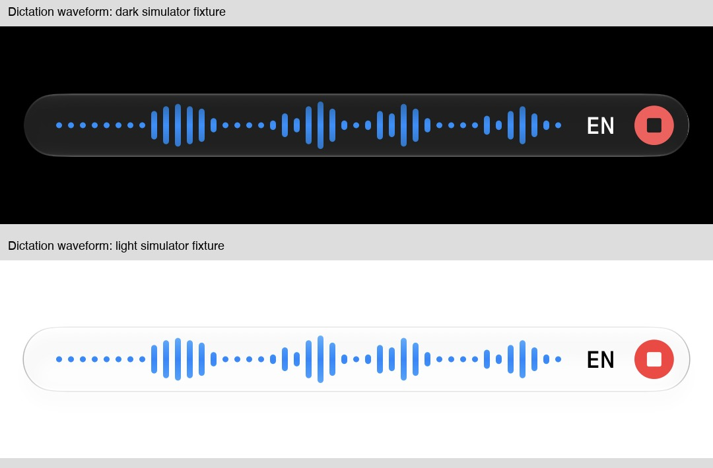

# Liquid Glass audit

Issue #207 uses the iOS 26 and watchOS 26 glass APIs directly. The minimum versions stay at 26. System navigation, sheets, menus, pickers and search retain their native styling.

| Screen or surface | Decision |
| --- | --- |
| Agents / Usage switcher | Native segmented control, matching Chat/Terminal and inbox filters, with the system sliding glass selection, a shared adaptive black/white selection tint and semibold labels with accent-colored selected text. Native paging reveals Usage progressively during a drag. Navigation and tab bars retain system glass. |
| Agent inbox | Native segmented control for filters, with the search field on its own glass below it, both in a top inset the rows scroll under. Agent rows, state badges and unread indicators stay content. |
| Agent grid | Cards left as content: terminal previews need a stable background. Context menus use system styling. Like every Agents page (grid, list, inbox, Usage), no band sits behind the navigation bar or the tab bar: the system scroll edge effects are hidden and no glass or dimming is added, so content runs under both at full clarity and only the picker, buttons and tab bar show, each on its own glass. |
| Agent session | Native segmented Chat/Terminal control at the right of the session header, with icon-only segments (a speech bubble symbol and the Ghostty icon). The bold inline title wraps to two lines and is cut without an ellipsis. Glass applied to the composer, terminal keys, jump and notice actions, upload and dictation controls, attachment removal and unlock action. Attachment content sits outside the glass composer. The header (under the navigation bar, with the subagent list) sits on full-width, edge-to-edge clear glass over a dimming layer, so the conversation and terminal run under it, with the system scroll edge effect under the navigation bar hidden so the whole header reads as one glass area. The composer has no band: the conversation and terminal show through around its controls, which keep their own glass, and its notice, error, retry and dictation problem lines each sit on their own regular glass, since bare text there was unreadable over scrolled-back content. Over the always-dark terminal the header, the composer's controls and the navigation bar use the dark appearance, the header and navigation bar only while the terminal runs under them. Text in the header, including the elapsed time and the subagent rows' time and tokens, uses the primary color: secondary gray was hard to read on clear glass. The header's status pill sits on a translucent fill like the Chat/Terminal track rather than its own dark glass. The lock notice remains content. |
| Conversation | Already uses glass for search, copy and navigation actions. Messages and code remain content. |
| Git changes / diff review | Already uses glass from #205. No changes in this audit. |
| New task | Glass applied to the composer and shared attachment, upload and dictation controls. Folder choices and task settings remain form content. |
| Approvals | Glass applied to decision buttons, with green for Approve. Actions stack at accessibility text sizes. Commands, notes and question choices remain content. |
| Saved prompts / editor | System navigation, sheets and toolbar actions. Plain row buttons prevent blue tint from dimming prompt text; larger previews improve readability. Rows and editor remain content. |
| Plan usage | Left as content: usage bars, figures and reset times need stable backgrounds. |
| Machines / machine settings / pairing | Already uses system navigation, forms, sheets and toolbar actions. Machine details remain content. |
| QR scanner | Already uses system scanner UI and a native Cancel toolbar item. |
| Settings / gestures | System navigation and switches, with a selectable accent color. Diagnostic values remain list content. |
| Onboarding | Glass applied to sign-in and auth-key actions. Instructions and input remain form content. |
| Watch home / agents | Already uses system lists and navigation. Agent status remains content. |
| Watch approval detail | Glass applied to Approve, Deny and question actions. Commands and status remain content. |
| Watch usage detail | Compact native list with logo gauges, window labels, percentages and reset countdowns. Tapping a window opens its countdown, reading age and elapsed percentage. No glass on content. |
| Watch complications / Smart Stack | Rectangular widget redesigned with three native `Gauge` controls using `.accessoryCircular`. Provider sits inside and a bold reset countdown sits below. A value-based tint dims the unused arc while retaining the native marker. Window labels are omitted to maximize gauge space. Percentages are shown in the app after tapping. Native markers indicate usage; the circular complication retains elapsed-time ticks. Preserve stale and missing-data states. Gauges use `widgetAccentable`; no extra glass layer. |
| Live Activity / Dynamic Island | System-hosted surface. Remove forced black background, white system actions and dark appearance from the Lock Screen activity. Status pills remain content and approval buttons keep the native widget button style. |

Standalone terminal keys, attachments, dictation, send, keyboard dismissal and attachment removal use native glass button styles. The shared attachment button keeps its native menu stable while open and presents Saved prompts, Files or Photo Library after dismissal completes. Its 16-point paperclip uses the chosen app accent. Its glass circle matches the 38-point dictation, keyboard and send circles, and its 44-point hit target extends past the circle. Picker presentation is local and does not wait for the machine; the upload chip distinguishes preparing a file, waiting for the machine and upload progress. The wrap-lines control is a toolbar button on the shared glass capsule, its icon in the accent when on and the primary color when off, like the other glass toolbar icons; a button-style toggle would fill the bar item. Its title carries the state (Wrap lines on or off), because bar buttons pass only their title to accessibility. Chat/Terminal uses a compact icon-only selector in the session header row, with 44-point segments and the VoiceOver labels Chat and Terminal. It has no glass backing: an extra glass layer beside other glass left keyboard animations unfinished after a picker closed. Segmented controls use accent-colored selected text and the same adaptive black/white selection tint in both toolbar and content placements, keeping Chat/Terminal dark like Agents/Usage in dark mode rather than adopting an elevated gray. Approval disclosure uses a native button. Adjacent custom glass controls share `GlassEffectContainer`. Controls inside a glass composer or dictation capsule do not add another glass surface. The accent-colored dictation waveform uses a translucent gradient, becoming solid with Reduce Transparency or Increase Contrast. It fills the available capsule width with recent microphone levels, including repeated levels and silence, with a more sensitive microphone level scale; history clears when dictation stops or switches language. Agents/Usage uses native interactive page scrolling instead of a gesture that switches only after release. In a toolbar, UIKit leaves a tapped segmented control's press lens over its selection, keeping the selected label in its pressed tint; the control is re-added to its window once the lens settles, which restores the accent, and keeps its frame. Segmented controls drop UIKit's one-point bottom alignment inset, which they draw over, so Agents/Usage matches the height of the glass capsule beside it. Page transitions triggered by the selector respect Reduce Motion.

Reference: [Apple's Liquid Glass guidance](https://developer.apple.com/documentation/swiftui/applying-liquid-glass-to-custom-views).

The follow-up control audit found native `List`, `NavigationLink` and `Gauge` views throughout the watch app and widgets. Watch Approve uses `.glassProminent`; Deny and answer choices use `.glass`. No watch control replacement was needed.

## Validation

Prioritize dark mode while retaining native appearance and accessibility behavior. Glass uses the system material and respects the user's glass setting.

- `just ios-test`: passed, including 274 app tests and 62 Ghostty tests.
- `just lint`: passed. The later Codex prompt reflow change also passed all 334 `collied` tests, targeted Clippy and formatting checks; its regression fails before the fix and passes afterward.
- Signed iPhone build, embedded watch app and widgets: built successfully and passed signature verification.
- Reviewed the final diff for approval guards, disabled states, composer behavior and widget missing/stale states. Fixed clipped terminal key labels during visual review. Physical watch feedback exposed a widget-only collapse in the geometry-scaled gauges; the updated implementation removes that transform and shares the plain native gauge with usage detail.
- Simulator fixtures covered light, dark, Increase Contrast, accessibility text sizes and actual Reduce Transparency. Verified native paging at a partial offset with both pages visible and after settling on Usage. Approval actions stack at accessibility sizes. Existing agent header/key clipping at extreme text sizes remains outside this change.
- Dictation fixtures cover dark/light appearance, a narrow bar and accessibility text with Increase Contrast. Session tests verify speech and silence history, its size bound, and clearing on stop, cancellation and language changes. The user accepted the latest phone build after the microphone sensitivity adjustment.
- Native watch simulator previews and rectangular fixtures cover reset countdowns and missing data. Standalone previews did not reproduce the physical widget layout failure. Physical feedback confirmed the collapse was resolved. Physical feedback confirmed the compact usage list looks good. The widget now dims its unused arc and uses bold countdowns; the user accepted these final refinements on the physical watch.

These screenshots use deterministic fixtures rendered with production views. The watch simulator image uses a temporary host app with the production gauge view, rather than a configured watch face.

| Light | Dark | Reduce Transparency |
| --- | --- | --- |
|  |  |  |

The latest signed build was installed and launched on the physical iPhone. The signed Mac companion was updated and restarted; status and doctor checks passed. Its Codex-only prompt reflow fix joins continuations at the source terminal width while preserving short explicit newlines and structured rows. Physical photos confirmed the watch update transferred and the Plan Usage layout was accepted. The user accepted the final widget and microphone sensitivity refinements and authorized auto-merge. Remaining manual checks: the iOS 27 glass setting extremes, Live Activity clear/tinted Lock Screen styles, actual watch face accenting, and physical watch readability. Simulator fixtures do not validate those system-hosted presentations.
