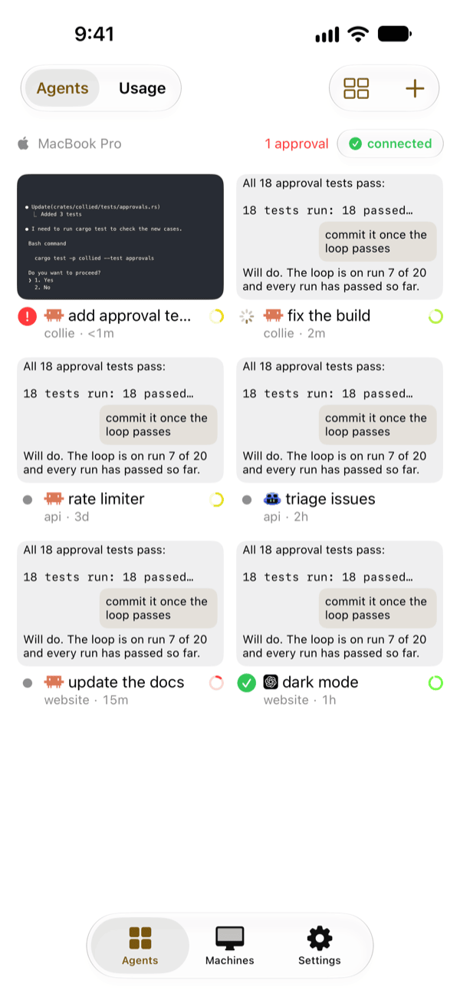

# Agents

The **Agents** tab lists every herdr agent on every paired machine, grouped by machine with blocked agents first. Each agent shows its status: `idle`, `working`, `blocked` or `done`. A machine that is asleep or off shows as offline and does not slow down the others.

Pull down to retry every machine, or tap a machine's header to retry that one.

In every layout and in Usage, the content scrolls under the buttons at the top and the tab bar at the bottom and stays fully visible around them: no band covers either edge.

## Machine order

To arrange your machines, open **Machines**, tap **Edit**, drag the reorder handles, then tap **Done**. The phone keeps this order across app restarts and uses it in the grouped Agents layouts, in Usage and when you move between agents on different machines. Offline machines keep their positions, newly paired machines go to the end, and a removed machine leaves the order.

Agents keep their order within each machine. Inbox still ranks agents by status and priority across machines.

## Layouts

The Agents tab has three layouts.

### Grid

The default. Each card is a live preview of the agent's screen. Claude Code, Codex and Copilot CLI cards show the agent's output without its input box and status lines. A blocked agent's card shows its whole screen.

When **Settings > Sessions > Default view** is Chat, cards preview the conversation instead: your last two messages and the agent's last two replies, in order, without tool calls. A starred card shows more of each message. A blocked agent's card still shows its whole screen, so you can see the prompt. A card also shows the screen when Chat is not available for the agent, or when `collied` on its machine needs an update. When you change the setting, the grid follows it the next time you open the Agents tab.

[Running subagents](#running-subagents) appear on glass at the top of the preview. Each shows its title and elapsed time, updated every minute. A normal card lists up to two subagents and a starred card up to four, then "+N more". The latest output stays visible below the list, and at accessibility text sizes the preview grows to fit both. The list disappears when the subagents finish. While the agent is blocked, the card hides the list so the prompt stays visible. VoiceOver reads the subagents with the card.

- **Star** a card with a long press. Starred cards lead their machine's section at twice the height. The machine keeps stars for all your phones until the pane closes or you remove the machine.
- **Reorder** by dragging a card to an insertion line. Moving a card between the starred and unstarred groups also stars or unstars it. This phone keeps the order.

Cards stay in place when statuses change. You can drop a card above or below a starred card, or on any edge of an unstarred card in a grid with several rows. A single row offers only left and right, and a single column only above and below. When the other group is empty, a glass drop area appears during the drag: drop above the cards to star, below them to unstar. The Agents page stays in place until the drag ends.

### List

A compact list of agents, with their status as icons.

### Inbox

Search agents across machines with the field below the filters, and filter them:

- **Needs attention**: blocked agents and recent completions.
- **Working**: agents that are working, including blocked ones.
- **Inactive**: idle agents and completions older than 24 hours.

Each row shows the latest reply, your last prompt, the workspace, agent kind, machine and elapsed time.

To hide a row, swipe it to the right and choose **Snooze**: for 1 hour, 4 hours, until 8:00 the next morning or until a time you pick. A snoozed agent comes back early when it blocks or finishes another turn. You cannot snooze a blocked agent. Snoozed agents wait in a collapsed **Snoozed** section; to bring one back, long-press it and choose **Wake now**. This phone keeps your snoozes.

## Remaining context

A small ring shows how much context a Claude Code or Codex agent has left. `collied` reads it from the agent's transcript on the machine.

## Running subagents

Claude Code, GitHub Copilot CLI and Codex agents show their running subagents, each with a title and elapsed time. A subagent disappears when it finishes or is interrupted. When it gets a follow-up, its elapsed time starts again.

After Copilot's `/new`, the same pane shows a new conversation, and Collie follows it. When Collie cannot tell which conversation the pane shows, it does not guess.

Subagents can take a few refreshes to appear when the session's event log is large. Collie does not show:

- idle subagents, or subagents of other sessions;
- a subagent that never writes its identifying metadata;
- subagents forked by older Codex versions that do not mark where the inherited history ends.

Subagents also affect [archiving when the pull request merges](pull-requests.md#archive-when-the-pull-request-merges). Collie does not archive a workspace while a subagent runs, while it cannot read a known subagent's data, or while it cannot tell which conversation a Copilot pane shows. Background work that a Copilot pane still holds in an earlier conversation also blocks archiving, without appearing under the current one. Unused Codex threads do not count as subagents and do not block archiving.

## Agent actions

Long-press an agent, or use the agent screen's menu, to:

- follow it on the Lock Screen (see [Live Activities](../notifications/live-activities.md));
- close its pane or workspace;
- open its [Git changes](git-changes.md).

**Focus on** followed by the machine name brings the agent's pane to the front in herdr on that machine.

## Appearance

Choose an accent color in **Settings > Appearance > Accent color**: Blue (the default), Orange, Green, Red or Dark Gold. The choice applies to this phone only. Destructive actions stay red, and status colors keep their meaning.
