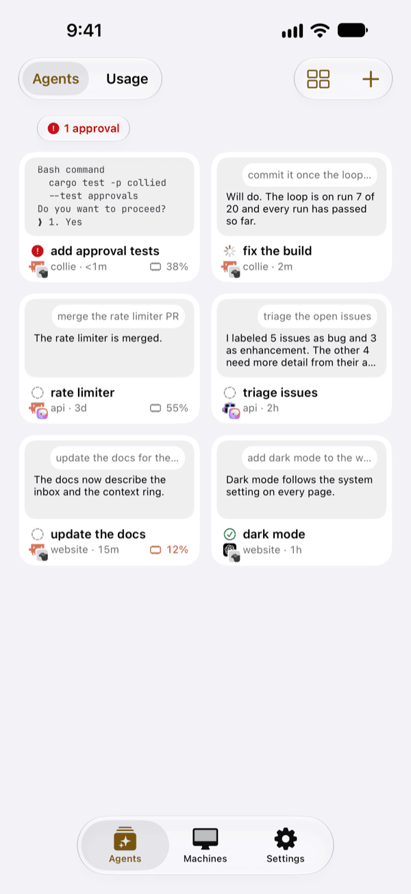
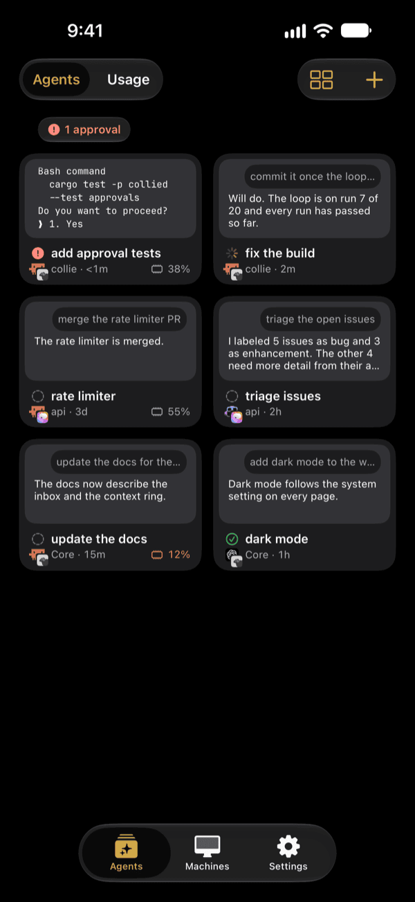

# Agents

The **Agents** tab lists the agents on every paired machine, each with its status: `idle`, `working`, `blocked` or `done`. A working agent shows a spinner in the app's accent; an outline circle marks the other statuses: a faint dashed one for idle, a check in green for done; only a blocked agent gets a filled red disc, so the agents that need you stand out. A machine that is connecting or offline says so after its name. Agents in herdr-core (Herdr Core) appear in a group of their own named **Herdr Core**, after the machine's herdr workspaces. Agents in Rex appear in one group per Rex session, named after the session, after the Herdr Core group. On the corner of each agent's own mark, cards, rows and the session header show the mark of what it runs in: herdr's for herdr and Herdr Core, Rex's for Rex. Beside herdr's mark, a Herdr Core agent's card or row shows the name of its folder, or **Core** when it has none, and the session header, which shows no group name, adds **Core** after the mark. An older collied does not say, and then no mark shows. To hide the marks, turn off **Settings > Sessions > Runtime icons**. In Herdr Core and Rex, only Claude Code and Codex take prompts or keys from the phone. Copilot CLI 1.0.106 and later shows its status, `idle`, `working`, `blocked` or `done`, but takes no input, since it says it is idle even while it asks whether to trust the folder, except the terminal's arrow keys, Return, Esc and a digit while that prompt is up; an agent that reports no status shows as `unknown` and takes no input either, except Codex at its folder trust prompt or update picker, which takes the terminal's arrow keys, Return, Esc and a digit. A machine that is asleep or off shows as offline without slowing down the others. Pull down to retry every machine, or tap a machine's header to retry that one. With one machine paired and connected, its header is only the approvals count, which is not a button.

## Machine order

To arrange your machines, open **Machines**, tap **Edit**, drag the handles, then tap **Done**. Grid, List and Usage follow this order, as does swiping between agents opened from Grid or List; Inbox sorts by status. This phone keeps the order, and newly paired machines go to the end.

## Layouts

The layout button at the top switches between Grid, List and Inbox. List is a compact list grouped by machine, blocked agents first. With one machine paired, Grid and List leave its name out; its pending approvals and any link problem still show above its agents. Tap the approvals count to open the agent that waits. On Usage, the layout and search buttons hide, and only **+** stays.

### Grid

Each machine gets a section of cards. A card leads with a preview, then one line with the agent's status and title, and one with its workspace, time in its status and remaining context. When several agents on a machine share a workspace or a Rex session, each shows the name of its folder instead, on cards and on List and Inbox rows. A Herdr Core agent always shows its folder, also when it is alone in its core. While **Settings > Sessions > Default view** is Chat (the default), a card previews the end of the conversation, the latest message at the bottom; a starred card shows more of it. Set to Terminal, it previews the bottom of the agent's screen, on the same gray panel as a conversation. A blocked agent's card always shows its screen, ending at the prompt's first choice so the command it asks about stays in view; other cards show [running subagents](#running-subagents) at the top.

- **Star** a card: long-press it and choose **Star**. Starred cards lead their machine's section, full width with a taller preview. The machine keeps stars for all your phones until the pane closes or you remove the machine.
- **Reorder** cards by dragging. Dropping a card among the starred cards stars it, and among the others unstars it; when one group is empty, drop on **Drop here to star** or **Drop here to unstar**. This phone keeps the order.

### Inbox

One list of the agents on every machine, grouped by status: blocked agents under **Needs you** at the top, then **Working**, **Done** (finished in the last 24 hours) and **Inactive** (idle, or finished earlier). Each row leads with the agent's title and time, then its latest reply, or else your last prompt, then its workspace or folder, as on a card, machine (when you paired more than one) and remaining context. A dot after the time marks a finished agent you have not opened since. Filter the list to one of its groups, which then shows without its heading, as the filter already names it; on a narrower phone or with larger text, swipe the filters sideways to reach the last ones, and the row scrolls back to the filter you chose whenever the inbox appears. Tap the search button at the top, beside the layout button, to search every group by title, the workspace or folder a row shows, machine or agent, whatever the filter. The search field takes the filters' place; tap its close button to return to them, your filter still selected.

To hide an agent that is not blocked, swipe its row right, choose **Snooze**, then **1 hour**, **4 hours**, the next 8:00 (**Today 8:00** or **Tomorrow 8:00**) or **Custom**. It waits in the collapsed **Snoozed** section until then, or until it blocks or finishes another turn; long-press it and choose **Wake now** to bring it back sooner. This phone keeps your snoozes.

## Remaining context

Once a Claude Code or Codex agent has less than 70% of its context left, a chip and a percentage such as **38%** show how much remains, in orange from 20% and red from 10%; Codex needs [herdr's hook](../agents/codex.md#set-up). For Claude Code, the percentage counts down to auto-compact, like Claude Code's own "until auto-compact" indicator, or to the full context window when auto-compact is off in `/config`.

## Running subagents

Claude Code, Copilot CLI and Codex agents show their running subagents, each with a title and elapsed time; Codex needs [herdr's hook](../agents/codex.md#set-up). In a session with a large event log, subagents can take a few refreshes to appear.

## Agent actions

Long-press an agent to follow it on the Lock Screen ([Live Activities](../notifications/live-activities.md)), close its pane or workspace, or [archive](new-task.md#archive) it. For a Herdr Core agent, you can follow it, watch its screen in **Terminal** and on grid cards, prompt it, send it keys, answer its approvals, [archive](new-task.md#archive) its task, and close it, which ends its program and removes its terminal; the machine refuses to close the Herdr Core group, which would end every terminal in it, and to focus a Herdr Core agent. A Herdr Core or Rex agent you started from a shell and suspend with Ctrl+Z leaves the list, and its Live Activity ends, until you bring it back with `fg` in that shell; an agent started through a shell wrapper that keeps the terminal, such as a terminal started as `sh -c 'cd x && claude'`, does not appear among the agents. In Rex, that terminal leaves [Terminals](../install/terminals.md) once the agent reports its status, and comes back when the wrapper exits, not the agent (`sh -c 'claude; make'` stays hidden while `sh` leads), or when you suspend it while the agent is idle or done; until the agent's first report, what you type there reaches the agent. Collie shows a Claude Code or Codex agent's conversation in [Chat](chat-terminal.md#chat). A session's **More** menu offers the same actions, plus [Git changes](git-changes.md), **Refresh**, and **Focus on** followed by the machine name, which brings the agent's pane to the front in herdr on that machine; for a Herdr Core or Rex agent, the app shows that the machine refused.

A Rex agent offers the same actions as a Herdr Core agent. Closing it ends its program and closes its block, and its session stays in Rex.app. The machine refuses to close a Rex session, which would end everything in it, your own Rex.app terminals included, and to focus a Rex agent, since Rex.app does not follow a focus request. Unlike herdr and Herdr Core, Rex cannot hold a prompt back while a dialog opens or while you type on the Mac: collie checks the agent's status just before it sends, but a dialog that opens in that instant takes the prompt's Return, which picks its highlighted option.

## Appearance

**Settings > Appearance > Accent color** sets the accent on this phone: None, Blue (the default), Orange, Green, Red or Dark Gold. None uses black or white for the highest contrast. Working agents show in the accent, as do their Live Activities and the Apple Watch's list; a Live Activity takes a new accent at its next update.

**Settings > Appearance > Glass** sets how much of the terminal or the chat shows through the glass the app draws: Clear shows more of it, sharper but dimmed; Regular (the default) blurs it; Opaque hides it behind the page's own background. The choice applies at once. Under Clear, the session header dims what shows through more than the controls do, so its title and status stay readable over a full terminal or chat. Under Clear, the Agents tab's cards and Usage scroll under the top bar in full view, with only the picker and its buttons on glass, as at the tab bar; Regular and Opaque keep the page's background there. The navigation bar, the tab bar and their buttons belong to iOS and follow its own Liquid Glass setting instead.

**Settings > Appearance > Preview zoom** scales the text inside the Agents grid's card previews from 50% to 125% (100% by default). Zooming out fits more terminal lines or chat messages into each card; zooming in makes the preview larger. This phone keeps the setting, and changes apply at once.
