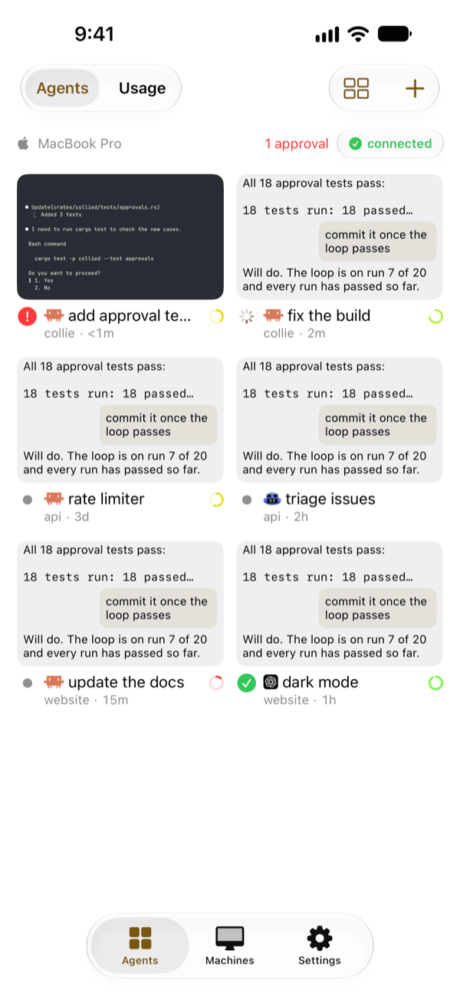
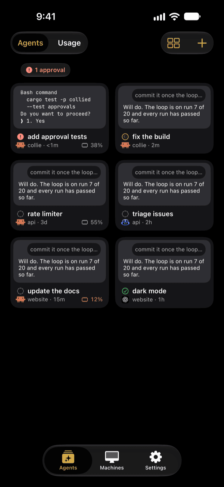

# Agents

The **Agents** tab lists the herdr agents on every paired machine, each with its status: `idle`, `working`, `blocked` or `done`. An outline circle marks each status: a faint dashed one for idle, a turning ring in the app's accent for working, a check in green for done; only a blocked agent gets a filled red disc, so the agents that need you stand out. A green dot after a machine's name means it is connected. Agents in herdr-core (Herdr 2) appear in a group of their own named **Herdr 2**, after the machine's herdr workspaces; an agent that does not report its status there, such as Copilot CLI, shows as `unknown` and takes no prompts or keys from the phone. A machine that is asleep or off shows as offline without slowing down the others. Pull down to retry every machine, or tap a machine's header to retry that one.

## Machine order

To arrange your machines, open **Machines**, tap **Edit**, drag the handles, then tap **Done**. Grid, List and Usage follow this order, as does swiping between agents opened from Grid or List; Inbox sorts by status. This phone keeps the order, and newly paired machines go to the end.

## Layouts

The layout button at the top switches between Grid, List and Inbox. List is a compact list grouped by machine, blocked agents first. On Usage, the layout and search buttons hide, and only **+** stays.

### Grid

Each machine gets a section of cards. A card leads with a preview, then one line with the agent's status and title, and one with its workspace, time in its status and remaining context. While **Settings > Sessions > Default view** is Chat (the default), a card previews the end of the conversation, the latest message at the bottom; a starred card shows more of it. Set to Terminal, it previews the bottom of the agent's screen, on the same gray panel as a conversation. A blocked agent's card always shows its screen, ending at the prompt's first choice so the command it asks about stays in view; other cards show [running subagents](#running-subagents) at the top.

- **Star** a card: long-press it and choose **Star**. Starred cards lead their machine's section, full width with a taller preview. The machine keeps stars for all your phones until the pane closes or you remove the machine.
- **Reorder** cards by dragging. Dropping a card among the starred cards stars it, and among the others unstars it; when one group is empty, drop on **Drop here to star** or **Drop here to unstar**. This phone keeps the order.

### Inbox

One list of the agents on every machine, grouped by status: blocked agents under **Needs you** at the top, then **Working**, **Done** (finished in the last 24 hours) and **Inactive** (idle, or finished earlier). Each row leads with the agent's title and time, then its latest reply, or else your last prompt, then its workspace, machine and remaining context. A dot after the time marks a finished agent you have not opened since. Filter the list to one of its groups; on a narrower phone or with larger text, swipe the filters sideways to reach the last ones, and the row scrolls back to the filter you chose whenever the inbox appears. Tap the search button at the top, beside the layout button, to search every group by title, workspace, machine or agent, whatever the filter; tap the close button to return to the filters, your filter still selected.

To hide an agent that is not blocked, swipe its row right, choose **Snooze**, then **1 hour**, **4 hours**, the next 8:00 (**Today 8:00** or **Tomorrow 8:00**) or **Custom**. It waits in the collapsed **Snoozed** section until then, or until it blocks or finishes another turn; long-press it and choose **Wake now** to bring it back sooner. This phone keeps your snoozes.

## Remaining context

A chip and a percentage such as **38%** show how much context a Claude Code or Codex agent has left, in orange from 20% and red from 10%; Codex needs [herdr's hook](../agents/codex.md#set-up). For Claude Code, the percentage counts down to auto-compact, like Claude Code's own "until auto-compact" indicator, or to the full context window when auto-compact is off in `/config`.

## Running subagents

Claude Code, Copilot CLI and Codex agents show their running subagents, each with a title and elapsed time; Codex needs [herdr's hook](../agents/codex.md#set-up). In a session with a large event log, subagents can take a few refreshes to appear.

## Agent actions

Long-press an agent to follow it on the Lock Screen ([Live Activities](../notifications/live-activities.md)), close its pane or workspace, or [archive](new-task.md#archive) it. For a Herdr 2 agent, you can follow it, watch its screen in **Terminal** and on grid cards, prompt it, send it keys, answer its approvals, [archive](new-task.md#archive) its task, and close it, which ends its program and removes its terminal; the machine refuses to close the Herdr 2 group, which would end every terminal in it, and to focus a Herdr 2 agent. A Herdr 2 agent you suspend with Ctrl+Z leaves the list, and its Live Activity ends, until you bring it back with `fg`; an agent started through a shell wrapper that keeps the terminal, such as a terminal started as `sh -c 'cd x && claude'`, does not appear. Collie shows a Claude Code or Codex agent's conversation in [Chat](chat-terminal.md#chat). A session's **More** menu offers the same actions, plus [Git changes](git-changes.md), **Refresh**, and **Focus on** followed by the machine name, which brings the agent's pane to the front in herdr on that machine.

## Appearance

**Settings > Appearance > Accent color** sets the accent on this phone: None, Blue (the default), Orange, Green, Red or Dark Gold. None uses black or white for the highest contrast. Working agents show in the accent, as do their Live Activities and the Apple Watch's list; a Live Activity takes a new accent at its next update.
