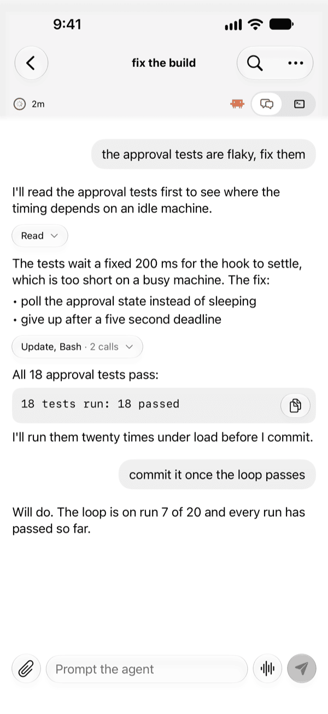
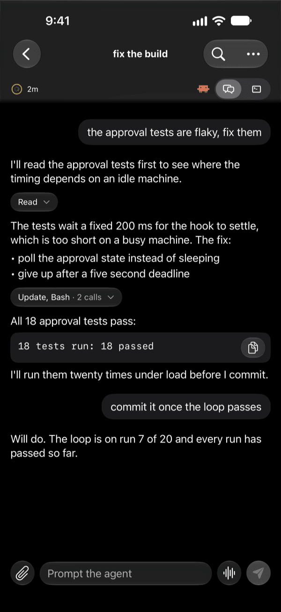
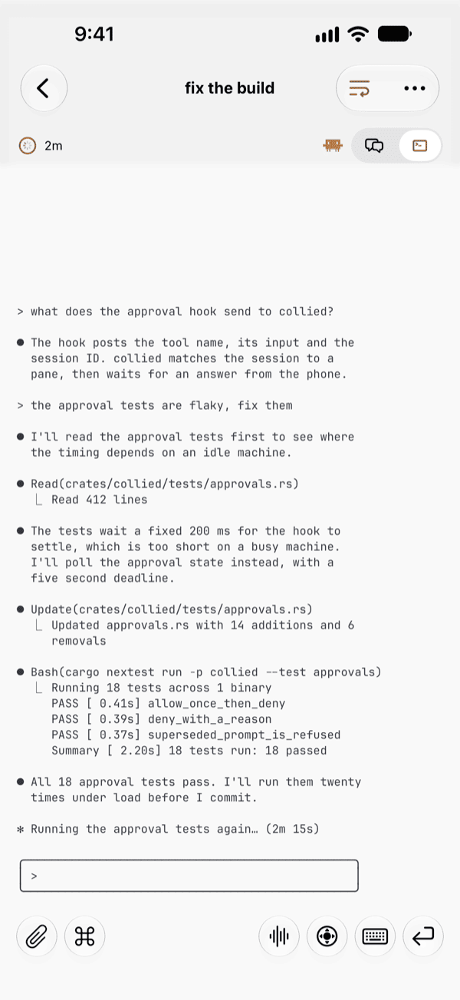
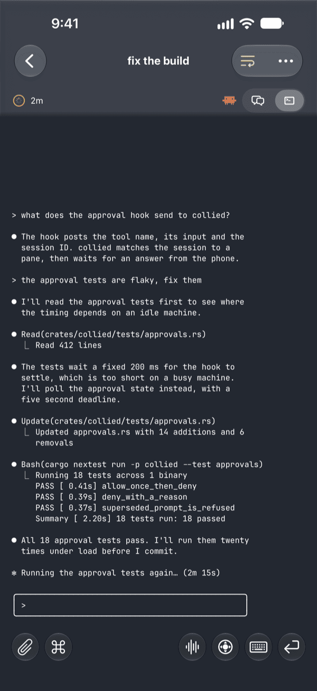

# Chat and Terminal

A Claude Code, Codex or Copilot CLI session has two views: **Chat** shows the conversation, and **Terminal** shows the agent's screen. Switch with the toggle at the top of the session. **Settings > Sessions > Default view** picks the view that opens first (Chat by default) and what [grid cards](agents-tab.md#grid) preview. Plain terminals have only Terminal.

The session header shows the agent's state and how long it has been in it, then its machine. The state shows as its icon alone: a spinner while the agent works, a green check when it is done.

With the largest text sizes (**Settings > Accessibility > Display & Text Size > Larger Text**), in portrait, the session's title moves from the top bar to the top of the session header, so it grows with your text. While an approval waits, it stays in the top bar to leave the approval room.

## Chat

- Long-press a message or a code block to **Copy** or **Quote** it; code blocks also have a Copy button, which shows a check mark once the code is on the clipboard, and tool records their own Quote and Copy buttons.
- Consecutive tool calls collapse into one row named after the tool, such as **Read · 1 call** or **Update, Bash · 2 calls**, or **Update and 2 more · 5 calls** from three tools on; expand it to see each call and its result.
- A [PR watch](pull-requests.md#watch-a-pull-request) wake shows as one row with an eye; tap it to read the full prompt.
- Tap **Load older messages** for more history, or the search button to find text in it.
- Tap a file path the agent mentions to [open the file](#open-a-file).
- When an interactive prompt needs terminal keys, tap **Continue in Terminal**.

> [!NOTE]
> Chat needs the session ID that herdr's SessionStart integration reports, and retries until it arrives. Codex needs [herdr's hook](../agents/codex.md#set-up), and in Herdr 2 also [collied's](../agents/codex.md#herdr-2). In Herdr 2, Chat finds a Claude Code session from the file Claude Code keeps for its process, with no hook. Copilot CLI needs none, but Chat waits until it can tell which conversation the pane shows: see [Copilot CLI](../agents/copilot.md).

### Open a file

Tap a file link in Chat, or select a path in Terminal and choose **Open**, to preview the file read-only:

| File | Up to | Preview |
|---|---|---|
| Images (PNG, JPEG, GIF, HEIC, WebP) and PDF | 20 MB | The file |
| Text and source | 1 MB | Monospaced, with a wrap button |
| Anything else | 20 MB | Name and size only |

**Copy** puts the file on the clipboard; **Share** saves or sends it.

`collied` opens only regular files inside the task roots (`roots` in [collied.toml](../operate/configuration.md#colliedtoml), your home folder by default). It refuses symlinks, paths with `..`, and hidden files and folders such as `.env`, except that an agent working inside a hidden folder, such as a worktree in `.worktree`, can open its own files.

## Terminal

Terminal shows the last 200 lines of the agent's pane, or 500 or 1000 with **Settings > Terminal > Scrollback**.

Terminal has no prompt field: you type straight into the pane, as in a terminal app.

- Tap the terminal, or the keyboard button, to bring up the keyboard; tap the button again to hide it. Every key goes to the agent as you type, so a `/` opens Claude Code's command menu right there. Return, Tab and Backspace act as those keys. Return also hides the keyboard, unless **Settings > Prompt > Keep keyboard open after sending** is on.
- The [key strip](keys.md) stays above the keyboard for Escape and Control. Its joystick sends the arrows; with the strip hidden, the joystick sits beside the keyboard button.
- In a Claude Code session, tap a word in the input box to move the cursor there and fix an earlier part of your prompt. While you type, Terminal keeps the input box above the keyboard; scroll away to read the rest, and it comes back when you type again or scroll to the bottom.
- Attach a file with the paperclip and its path on the machine is typed in; dictation types what you said once you stop. Saved prompts are typed too.
- Tap the return key at the right end of the bottom row to send what you dictated, without opening the keyboard; with the key strip shown, use the strip's return key. Like Return on the keyboard, it hides the keyboard unless **Keep keyboard open after sending** is on.

- Terminal follows your phone's appearance: light in Light Mode, dark in Dark Mode, switching as the phone does. Agents color their text for the machine's terminal, so in Light Mode Terminal darkens text too pale to read on its light background, and lightens text on the dark bands some agents draw.
- Lines wrap to the phone's width; turn off the wrap button to scroll long lines sideways.
- Long-press to select text, then copy it, quote it into the prompt or open a link. In an agent session, **Open** previews a selected file path.
- Terminal slows to one update a second in Low Data Mode.

## The prompt in Chat

- When a prompt cannot reach the machine, the send button spins while the phone retries, up to 5 tries in all, a minute apart or as soon as the connection is back. To stop, edit the prompt or tap the spinner.
- **Quote** adds text to the end of the prompt as a code block, without sending it. A prompt holds up to 32 KiB.
- To hide the keyboard, tap the hide-keyboard button or swipe down on the prompt field. **Settings > Prompt > Keep keyboard open after sending** keeps it up.
- When a background task or agent below Claude Code's input box is selected on the machine, Claude Code would not send your prompt, so the phone keeps it and says so. Drag the joystick up in Terminal, or press ↑ on the machine, to return to the input box, then send again.
- An unsent prompt stays with its agent on this phone, and its attachments for up to 23 hours.

See also [Key strip and gestures](keys.md), [Dictation and attachments](dictation-attachments.md), [Saved prompts](saved-prompts.md) and Claude Code's [draft sync](../agents/claude-code.md#draft-sync).
