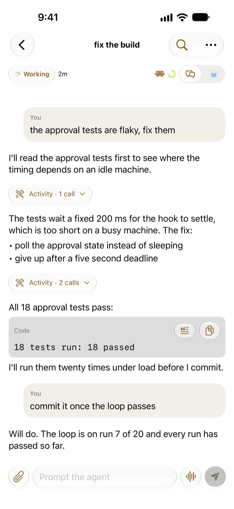
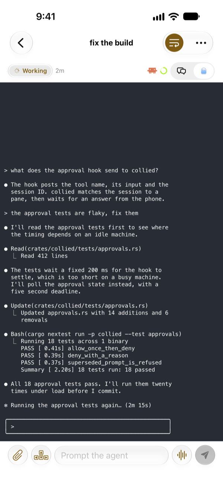
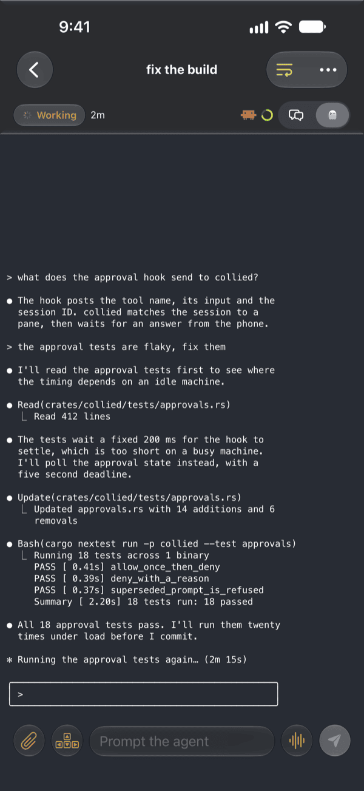

# Chat and Terminal

A Claude Code, Codex or Copilot CLI session has two views: **Chat** shows the conversation, and **Terminal** shows the agent's screen. Switch between them with the toggle at the top of the session. **Settings > Sessions > Default view** picks which one opens first and what the [grid cards](agents-tab.md#grid) preview; Chat is the default, and the toggle in a session does not change this setting. Plain terminals use Terminal only. Both views run the full height of the screen: the conversation or terminal shows through the header at the top and around the composer's controls at the bottom.

## Chat

Chat reads the agent's real conversation from its transcript on the machine.

- Replies render as Markdown, with selectable code blocks and Copy actions.
- Long-press a message to **Copy** or **Quote** it. Tool records and code blocks have Quote and Copy buttons.
- Consecutive tool calls collapse into one row; expand it to see each call with its result.
- A shell command you run in Claude Code with `!` shows as your message, such as `! git status`, with its output in plain text, collapsed in its own row below it.
- A prompt that [PR watch](pull-requests.md#watch-a-pull-request) typed to wake the agent shows as one compact row with an eye, such as "PR watch: CI failed on #123". Tap it to read the full prompt. A prompt you type yourself shows as your message unless it repeats a wake's text exactly.
- A recent page loads first. Tap **Load older messages** for more.
- The search button finds text across the history, with highlighted matches and previous and next buttons.
- New messages arrive while you read older ones, without jumping.

When an interactive prompt needs terminal keys, Chat offers **Continue in Terminal**.

> [!NOTE]
> Chat needs the agent's session ID from herdr's SessionStart integration. If the ID is missing, Chat says so and retries when it arrives; it never guesses a transcript from the folder. For Codex, install herdr's hook: see [Codex](../agents/codex.md). Copilot CLI needs no hook; Chat waits until it can tell which conversation the pane shows: see [Copilot CLI](../agents/copilot.md).

Chat shortens very long text and marks where it cut. The phone fetches history only while Chat is open, and stops loading when you switch to Terminal or leave the app. `collied` never writes history to logs or notifications.

## Terminal

Terminal shows the last 200 lines of the agent's pane (500 or 1000 in **Settings > Terminal > Scrollback**), rendered with libghostty-vt in the MesloLGS NF font.

- Turn on word wrapping to fit lines to the phone's width.
- Copilot CLI's scrollbar is hidden in both wrap modes. Text and input-box borders stay visible.
- Codex's input box and Claude Code's sent prompts keep their shaded background across wrapped lines. Codex prompt continuations wrap to the phone's width instead of keeping the desktop terminal's line breaks.
- Long-press to select and copy text (Universal Clipboard included), to quote it into the prompt or to open an http or https link. After a copy, a green checkmark and **Copied** appear briefly before the selection closes. Plain terminals have no **Quote**.
- Terminal updates up to four times a second. After 5 seconds without change, or while the iPhone is in Low Data Mode, it updates once a second.

## The prompt

The composer at the bottom works in both views.

- When a prompt cannot reach the machine, the phone sends it again up to 5 times, a minute apart or as soon as the connection is back, while the send button spins. To stop, edit the prompt or tap the spinner.
- **Quote**, in Chat or in the Terminal selection menu, adds the text to the end of the prompt as a code block and places the cursor after it. Quote never sends. If the prompt would grow past 32 KiB, Collie shows an error and leaves the prompt unchanged.
- **Settings > Prompt** can keep the keyboard open after sending.
- To hide the keyboard, tap the hide-keyboard button or swipe down on the prompt field. In a long prompt, a swipe down first scrolls back to the top, then hides the keyboard.
- Text you left unsent in Claude Code's input box on the machine fills an empty prompt field when you open the agent, on up to five lines.
- When the machine has selected a background task or agent below Claude Code's input box (with ↓ on its last line), the phone keeps the prompt and shows that the agent is not ready, because Claude Code would not send it. Press ↑ on the key strip or the machine to return to the input box, then send again.
- With the keyboard down, drag the prompt field to scroll a long prompt without opening the keyboard, tap it to edit and long-press it to copy it.
- An unsent prompt stays with its agent on this phone. Its attachments stay for up to 23 hours.

See also [Key strip and gestures](keys.md), [Dictation and attachments](dictation-attachments.md) and [Saved prompts](saved-prompts.md).
