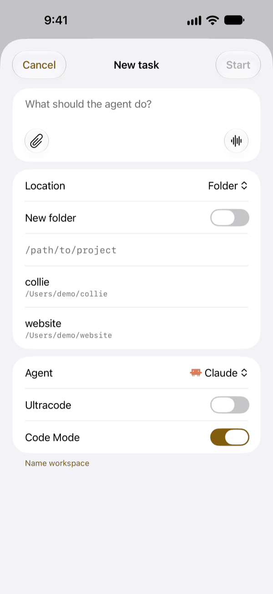
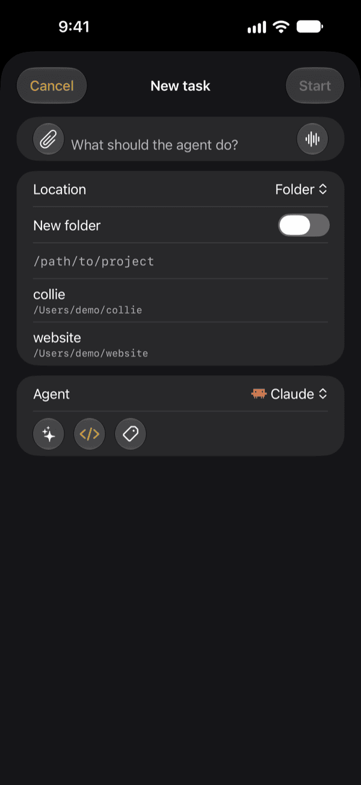

# New task

**New task** starts Claude Code, Codex, Copilot CLI or Antigravity CLI in a new herdr workspace on the machine you pick, or in [Herdr Core](#herdr-core) or [Rex](#rex) when herdr is not running there or when you [choose one](#where-tasks-start). Write what the agent should do, choose where it runs, then tap **Start** at the top right. While the task starts, **Start** shows a spinner and the title reads "Starting the task…", then "Waiting for the agent…".

If the agent stops on a startup prompt before taking your prompt (such as a folder trust question, an MCP server approval or Codex's update picker), collie leaves the prompt unsent, saves your prompt and any uploaded attachments in that session's Chat composer, and opens the new session directly in Terminal so you can answer the prompt there and switch to Chat to send.

## Plan usage

When the agent you pick has used 80% or more of a [plan limit](usage.md) on that machine, a line under the agent picker says so, such as "Claude 5-hour limit at 92%, resets at 3:40 PM". Like the Usage bars, the line is orange from 80% and red from 90%.

## Choose a folder

Each machine can have a **base folder** (**Machines** > the machine > **Base folder**). Give its full path, such as `/Users/you/git`: collie does not expand `~`. It must be inside one of `collied`'s task roots (`[tasks] roots` in `collied.toml`, your home folder by default).

Type a folder's name in the base, tap **Browse**, pick a recent folder (a path too long for the row shows its last folders, such as `…/git/collie`) or give an absolute path inside a task root. Until you choose one, **Start** stays dimmed, and once you write a prompt the empty folder field reads "Choose a folder to start" in orange. A checkmark marks the recent folder you chose. **New folder** creates an empty folder, without `git init`, in the base, or in a task root when no base is set.

## Clone a repository

Choose **Clone** and give `owner/repo`, an `https://` URL or a `git@host:path` address. `collied` clones it with `gh` or `git` into a new folder in the base (or a task root).

## Git worktree

Choose **Git worktree**, pick the repository as you would a folder, then:

- **Create** a new branch, named for you unless you type a name, with its checkout under the repository's `.worktree/` folder;
- **Open** an existing checkout;
- check out a **Pull request** of that repository by number; `collied` asks `gh` for its branch and fetches it from `origin`, and refuses pull requests from forks.

Check the branch and path before you tap **Start**. If the agent fails to start, the checkout and workspace stay, and the error names them.

## GitHub issue

Choose **GitHub issue**, pick the repository as you would a folder, then pick one of its 50 newest open issues, which `collied` lists with `gh`, one line each. `collied` creates the branch `issue-<number>` and its checkout under `.worktree/`, as **Create** does, and collie puts `Work on GitHub issue #<number>.` at the start of the prompt; picking another issue swaps that reference, and you can edit the prompt before you tap **Start**. You cannot pick an issue while you dictate. The agent reads the issue itself with `gh`; collie never sends its title or text. When `gh` is not signed in, or the repository has no GitHub remote, the sheet says why. To go back to an issue you started on, choose **Git worktree**, then **Open** and its checkout. **GitHub issue** shows only once `collied` on the machine is new enough.

## Resume a session

Choose **Resume** and a folder to list its recent Claude Code, Codex, Copilot CLI and Antigravity CLI sessions by first prompt, then resume one in a new workspace, with an optional prompt. Sessions already open in an agent, in herdr, Herdr Core or Rex, are left out, and so is a Copilot CLI session open anywhere on the machine. Antigravity CLI lists a conversation in the folder of its oldest prompt still in the CLI's recent prompt history, which is the folder you started it in unless its early prompts have aged out. Each agent lists its 20 most recent sessions.

## Options

- **Ultracode** (Claude Code only, off by default) turns on Claude Code's Ultracode setting; if it stays off, the task fails without sending the prompt.
- **Code Mode** (Claude Code only, on until you turn it off, remembered per machine) starts Claude Code with `CLAUDE_CODE_EXPERIMENTAL_CODE_MODE` set to 1, or to 0 when off. Turn it off to use Remote Control, which Claude Code does not offer in Code Mode. It also shows when you resume a Claude Code session, and only once `collied` on the machine is new enough. In Herdr Core and Rex the value wins over one your shell start-up files export. In herdr, Claude Code takes it as a setting: off always wins, but on cannot override a 0 that your start-up files export.
- **Name workspace**, under the agent, shows a field for the herdr workspace's label.
- Codex tasks start with `--no-daemon`: see [Codex](../agents/codex.md).

## Schedule a task

To start a task later, such as overnight or after a plan limit resets, turn on **Start later** under the agent and pick a date and time, in your phone's time zone, up to 24 hours ahead. **Start** then reads **Schedule**. The option shows once `collied` on the machine is new enough.

`collied` checks the task when you tap **Schedule**, as it checks one you start now: the folder must be inside a task root, the agent allowed and the runtime available. A mistake shows in the sheet at once, not at the start time. `collied` then keeps the task in its data folder, so a restart does not lose it, and at the start time starts it as if you had tapped **Start** then.

- The machine must be awake and `collied` running at the start time. If they come back within an hour of it, the task starts then; after that, `collied` drops it.
- An alert tells you when the task starts, fails or is dropped, and why. Tap a started task's alert to open its session.
- If the agent stops at a startup prompt, `collied` leaves your prompt unsent, as **Start** does, and the alert says so. The phone kept your prompt and attachments, and puts them in the session's Chat composer once it reaches the machine again.
- The sheet lists the machine's scheduled tasks under **Scheduled on** with their folder, agent and time. Swipe one to cancel it until it starts; once `collied` is starting it, the sheet says it can no longer be cancelled.
- Tap a scheduled task to edit its prompt, its attachments and its start time, again at most 24 hours ahead; **Save** replaces the task on the machine after the same checks as **Schedule**. The folder, agent and location stay as scheduled: to change them, cancel the task and schedule it again. Once `collied` is starting the task, it refuses the edit, and the sheet says so and keeps your changes. You can edit a task only from the phone that scheduled it, since only that phone holds its prompt, and only once `collied` on the machine is new enough.
- If `collied` stops while it starts a task, it does not start that task again when it is back, since the agent may already run, and an alert asks you to check the machine.
- A machine holds at most 10 scheduled tasks. `collied` deletes an attachment 24 hours after you upload it, so a task that starts later than that finds it gone.
- Revoking the phone that scheduled a task cancels the task.

## Where tasks start

**Settings > Sessions > Start tasks in** picks where New task starts agents, on every machine:

- **Automatic**, the default: herdr while it runs, otherwise Herdr Core, otherwise Rex.
- **Herdr**, **Herdr Core** or **Rex**: there and nowhere else, for prompts, folders, clones, Git worktrees, pull requests, issues and Resume.

When the machine last reported the runtime you chose as missing, a red line under the location says so before you tap **Start**. If the machine cannot start the task there, the sheet says why, such as "Rex is not running on this computer" or "Rex is reconnecting; try again in a moment", and keeps your prompt; nothing starts anywhere else. Once `collied` is updated, the **Agent** list offers only the agents the chosen runtime starts on that machine, as `collied` reports them. If the agent you had picked is not among them, such as after you switch machines, the sheet picks one that is. When the runtime can start none of the machine's agents, the sheet says so and keeps **Start** dimmed for a new prompt. With an older `collied`, the list is as before and **Start** refuses an agent the runtime cannot start, before anything is created. A machine whose `collied` is too old for the setting says so under the location and keeps **Start** dimmed until you update `collied` or choose Automatic.

## Archive

**Archive**, in a session's **More** menu or an agent's long-press menu, cleans up a finished task:

| Task in | Archive |
|---|---|
| A linked worktree | Closes the workspace and removes the checkout, **uncommitted changes included**, then runs `gh poi` to clean up merged branches and worktrees |
| A regular folder | Closes only the pane; runs `gh poi` when the repository is inside a task root |

Archiving the last pane of a repository workspace with linked worktree sessions leaves a shell there to keep those sessions open.

In Rex, **Archive** also removes the task's session from Rex.app's sidebar once nothing else is left in it. A session that still holds another window or block stays, as does any session collie did not create for the task. For a session collie created, the answer says whether it was removed.

One task works in a checkout at a time, whichever runtime started it. When Herdr Core or Rex runs beside herdr, herdr's **Archive** and **Open** leave a checkout alone while a Herdr Core terminal or a Rex block works in it, and say so, such as "a Rex block works in this checkout". A Herdr Core or Rex that does not answer never stops herdr. The other way round, an **Open** or **Archive** in Herdr Core or Rex leaves a checkout alone while a herdr pane works in it or herdr has it open, and refuses while herdr runs but does not answer.

## Herdr Core

When herdr is not running on the machine and herdr-core (Herdr Core) is, **New task** starts the agent in Herdr Core, in a terminal of its own in the machine's **Herdr Core** group. While herdr runs, tasks start in herdr. You change no setting, unless you want tasks in Herdr Core while herdr runs: choose it in [Where tasks start](#where-tasks-start).

- You can start Claude Code, Codex, Copilot CLI and Antigravity CLI, once `collied` finds them on the machine.
- Folders, clones, Git worktrees, pull requests, issues, Resume, Ultracode and Code Mode work as in herdr, but the task label is not kept: nothing in Herdr Core would show it. One task works in a worktree at a time: **Open** refuses a checkout another Herdr Core task already records. If the task fails after the agent starts, the agent keeps running and the checkout stays; the error names them.
- When Claude Code, Codex, Copilot CLI or Antigravity CLI stops on a startup question such as folder trust or Codex's update picker, collie leaves your prompt unsent, saves your prompt and attachments in the session's Chat composer, and opens the session in Terminal so you can answer it there. If an agent is not yet listed as an agent when the dialog appears, answer it on the machine instead.
- **Archive** of a worktree task collie started (Create, pull request, issue or Open) ends that task's agent and removes the checkout, **uncommitted changes included**, then runs `gh poi`; its answer names the agent it ended. It closes nothing while another herdr or Herdr Core terminal or task works in the checkout (a Resume started there included), while herdr runs and has the checkout open or does not answer, or while the worktree is locked. Windows in other apps, such as Terminal.app, an IDE or tmux, are not checked: close them first. A task whose agent already exited no longer shows, so you cannot archive it from the phone: remove its checkout on the machine. For a regular folder, an agent collie did not start, or a folder you picked that happens to be a worktree, it ends only that agent, keeps the folder and runs `gh poi` as in herdr. collie does not [archive a Herdr Core task by itself](pull-requests.md#archive-when-the-pull-request-merges) when its pull request merges.

## Rex

When neither herdr nor Herdr Core is running on the machine and Rex is, **New task** starts the agent in Rex, in a Rex session of its own, which Rex.app lists under the task's label or name. While herdr or Herdr Core runs, tasks start there; to start them in Rex anyway, choose Rex in [Where tasks start](#where-tasks-start).

- You can start Claude Code, Codex, Copilot CLI and Antigravity CLI, once `collied` finds them on the machine. The agent starts through your login shell, so it finds what your profile puts on its `PATH`, as in your own Rex terminals.
- Folders, clones, Git worktrees, pull requests, issues, Resume, Ultracode and Code Mode work as in Herdr Core, and a startup question stops the task the same way. **Name workspace** names the Rex session.
- **Archive** works as in [Herdr Core](#herdr-core): for a worktree task collie started, it ends the agent and removes the checkout, **uncommitted changes included**, unless anything else works in it, a shell in Rex.app included. Then it removes the task's Rex session if nothing else is left in it ([Archive](#archive)). An agent that exits on its own leaves its session, empty, in Rex.app: close it there.
- The agent's terminal takes the size of your tallest Rex terminal, so Claude Code's fullscreen screen fills the phone's Terminal view even while Rex.app does not show the session. Without a Rex terminal larger than 80x24 it stays 80x24. A task that an earlier `collied` left at 80x24 gets that size once, when the updated `collied` starts, and its agent keeps running; a size you give it afterwards stays.
- If `collied` loses Rex while a task starts, the error says an agent may have been started. Close such an agent from the phone while it runs, or in Rex.app once it exits; if it was a worktree task, remove its checkout on the machine.
- collie does not archive a Rex task by itself when its pull request merges.
