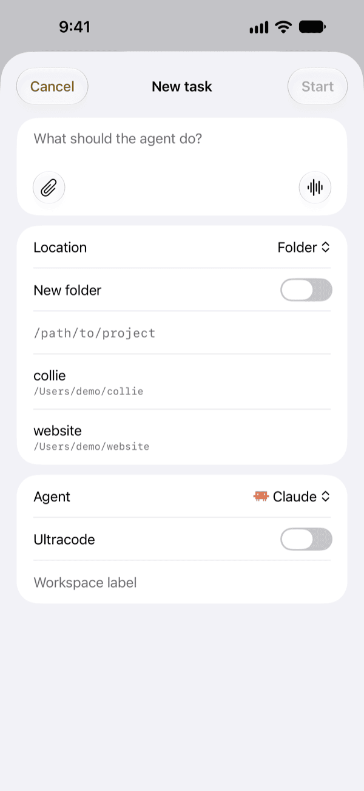
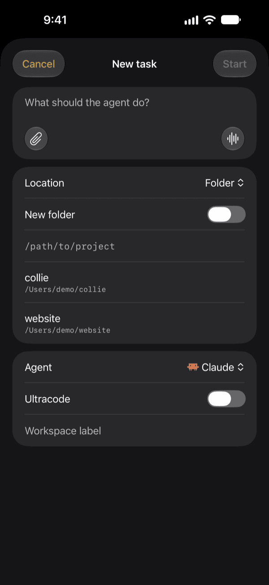

# New task

**New task** starts Claude Code, Codex or Copilot CLI in a new herdr workspace on the machine you pick, or Claude Code or Codex in [Herdr 2](#herdr-2) when herdr is not running there. Write what the agent should do, choose where it runs, then tap **Start** at the top right. While the task starts, **Start** shows a spinner and the title reads "Starting the task…", then "Waiting for the agent…".

## Plan usage

When the agent you pick has used 80% or more of a [plan limit](usage.md) on that machine, a line under the agent picker says so, such as "Claude 5-hour limit at 92%, resets at 3:40 PM", and turns orange at 100%.

## Choose a folder

Each machine can have a **base folder** (**Machines** > the machine > **Base folder**). Give its full path, such as `/Users/you/git`: collie does not expand `~`. It must be inside one of `collied`'s task roots (`[tasks] roots` in `collied.toml`, your home folder by default).

Type a folder's name in the base, tap **Browse**, pick a recent folder or give an absolute path inside a task root. **New folder** creates an empty folder, without `git init`, in the base, or in a task root when no base is set.

## Clone a repository

Choose **Clone** and give `owner/repo`, an `https://` URL or a `git@host:path` address. `collied` clones it with `gh` or `git` into a new folder in the base (or a task root).

## Git worktree

Choose **Git worktree**, pick the repository as you would a folder, then:

- **Create** a new branch, named for you unless you type a name, with its checkout under the repository's `.worktree/` folder;
- **Open** an existing checkout;
- check out a **Pull request** of that repository by number; `collied` asks `gh` for its branch and fetches it from `origin`, and refuses pull requests from forks.

Check the branch and path before you tap **Start**. If the agent fails to start, the checkout and workspace stay, and the error names them.

## Resume a session

Choose **Resume** and a folder to list its recent Claude Code and Codex sessions by first prompt, then resume one in a new workspace, with an optional prompt. Sessions already open in an agent, in herdr or Herdr 2, are left out.

## Options

- **Ultracode** (Claude Code only, off by default) turns on Claude Code's Ultracode setting; if it stays off, the task fails without sending the prompt.
- Codex tasks start with `--no-daemon`: see [Codex](../agents/codex.md).

## Archive

**Archive**, in a session's **More** menu or an agent's long-press menu, cleans up a finished task:

| Task in | Archive |
|---|---|
| A linked worktree | Closes the workspace and removes the checkout, **uncommitted changes included**, then runs `gh poi` to clean up merged branches and worktrees |
| A regular folder | Closes only the pane; runs `gh poi` when the repository is inside a task root |

Archiving the last pane of a repository workspace with linked worktree sessions leaves a shell there to keep those sessions open.

## Herdr 2

When herdr is not running on the machine and herdr-core (Herdr 2) is, **New task** starts the agent in Herdr 2, in a terminal of its own in the machine's **Herdr 2** group. While herdr runs, tasks start in herdr. You change no setting.

- You can start Claude Code and Codex, once `collied` finds them on the machine. Copilot CLI does not start there: it reports no status in Herdr 2, so collie could not tell when it is ready. Such a task fails before collie creates or clones a folder.
- Folders, clones, Git worktrees, pull requests, Resume and Ultracode work as in herdr, but the task label is not kept: nothing in Herdr 2 would show it. One task works in a worktree at a time: **Open** refuses a checkout another Herdr 2 task already records. If the task fails after the agent starts, the agent keeps running and the checkout stays; the error names them.
- When Claude Code asks whether to trust the folder, or shows another startup question, the task stops without sending your prompt. Answer it on the machine: Claude Code reports nothing while it asks, so no approval reaches the phone.
- **Archive** of a worktree task collie started (Create, pull request or Open) ends that task's agent and removes the checkout, **uncommitted changes included**, then runs `gh poi`; its answer names the agent it ended. It closes nothing while another herdr or Herdr 2 terminal or task works in the checkout (a Resume started there included), while herdr runs and has the checkout open or does not answer, or while the worktree is locked. Windows in other apps, such as Terminal.app, an IDE or tmux, are not checked: close them first. A task whose agent already exited no longer shows, so you cannot archive it from the phone: remove its checkout on the machine. For a regular folder, an agent collie did not start, or a folder you picked that happens to be a worktree, it ends only that agent, keeps the folder and runs `gh poi` as in herdr. collie does not [archive a Herdr 2 task by itself](pull-requests.md#archive-when-the-pull-request-merges) when its pull request merges.
