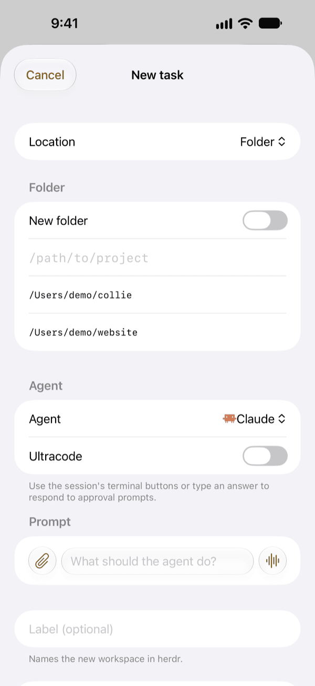
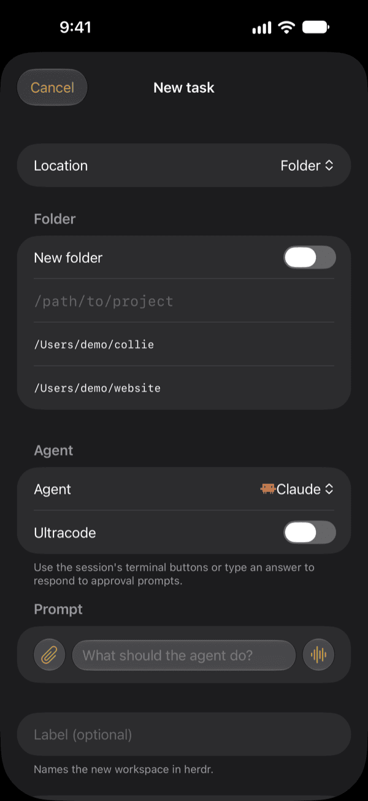

# New task

**New task** starts Claude Code, Codex or Copilot CLI in a new herdr workspace on the machine you pick. You can start in a folder, a new folder, a fresh clone, a Git worktree or a pull request branch, or resume an earlier session.

While you edit the prompt, its text and controls stay above the keyboard in portrait and landscape. To hide the keyboard, tap the hide-keyboard button below the prompt, or swipe down on any field.

## Plan usage

When the agent you pick is close to its plan limit on that machine, a line under the agent picker says so, with the time the limit resets, so you can pick another agent first:

- **Claude Code:** the 5-hour or weekly limit, once it reaches 80%, such as "Claude 5-hour limit at 92%, resets at 3:40 PM". At 100% the line turns orange and reads "Claude 5-hour limit reached".
- **Codex:** the monthly credits, the same way.
- **Copilot CLI:** the monthly premium usage, the same way, unless the seat is unlimited.

The figures come from [Usage](usage.md). When a reading is older than a few minutes, the line also says when the machine recorded it. The warning never stops you from tapping **Start**.

## Choose a folder

Each machine can have a **base folder** (Machines > the machine > Base folder). Give its full path, such as `/Users/you/git`, because collie does not expand `~`. The base folder must be inside one of `collied`'s task roots (`[tasks] roots` in `collied.toml`, your home folder by default).

- Type a name to pick that folder inside the base. Matching folders appear as you type.
- **Browse** lists the base's folders.
- Recent folders and absolute paths inside a task root also work.
- **New folder** creates an empty folder (no `git init`) in the base, or in a task root when no base is set, and starts the agent there. If the agent fails to start, the folder stays.

## Clone a repository

Give `owner/repo`, an `https://` URL or a `git@host:path` address. `collied` clones it into a new folder inside the chosen folder with `gh` or `git`, then starts the agent there.

## Git worktree

Choose **Git worktree** to work on a branch in its own checkout:

- **Create** makes a new branch (a name is generated unless you type one) and puts the checkout under the repository's `.worktree/` folder.
- **Open** picks an existing checkout from the list.
- **Pull request** takes the number of a pull request in that repository. `collied` asks `gh` for its branch, fetches it from `origin` and creates the checkout. Collie refuses pull requests from forks.

When no folder is selected yet, choose the repository: browse the base folder, type a name for matching folders, pick a recent folder, or enter the absolute path of a checkout inside a task root. Collie then lists its worktrees. Slashes in a custom branch name become hyphens in the checkout folder name.

Before you tap **Start**, check the branch and path shown. Collie starts the agent in the root pane that herdr returns, and refuses a pane where something already runs. If the agent fails to start, the checkout and workspace stay in place and the error names them.

## Resume a session

For Claude Code and Codex, New task can list a folder's recent sessions with their first prompt, and resume one in a new workspace. It leaves out sessions already open in a herdr pane.

## Options

- **Ultracode** (Claude Code only, off by default) starts the session with Claude Code's Ultracode setting. If Claude Code does not turn it on, the task fails without sending the prompt.
- Codex tasks start with `--no-daemon`: see [Codex](../agents/codex.md).

## Archive

**Archive**, in a session's menu, cleans up when you are done with a task.

- For a linked worktree, Archive closes the workspace and removes the checkout, including uncommitted changes. It then runs `gh poi` to clean up merged branches and worktrees.
- For a regular folder, Archive closes only the pane and leaves the folder in place. When the repository is inside a task root, it also runs `gh poi`.
- When the pane is the last one in a repository workspace that has linked worktree sessions, Archive leaves a shell there to keep those sessions open.

A banner shows progress, then confirms for 10 seconds, with brief details if cleanup needs attention. When you archive from a session, the app returns to the Agents tab.
