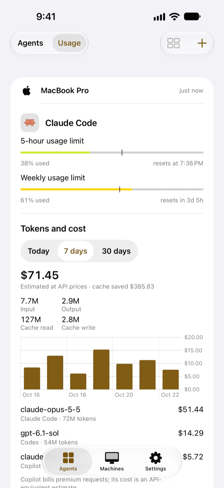
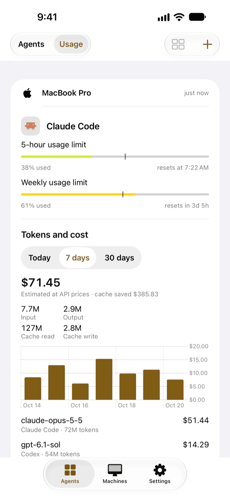
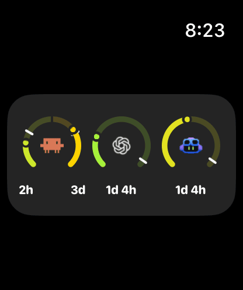

# Usage

To see plan usage and token cost, switch the Agents tab to **Usage**, or swipe left. Each machine gets a card, which says how long ago it recorded its plan usage.

| Agent | Shows | Source |
|---|---|---|
| Claude Code | 5-hour and weekly limits | The [status line tap](../install/claude-code.md#plan-usage) |
| Codex | Monthly used and allowed credits, and the reset date | The local Codex app-server, every five minutes, for a credit-metered workspace |
| Copilot | Monthly premium usage in percent, the used and allowed credits (or requests), and the reset date; "Unlimited" for a seat without a cap | GitHub, through the machine's own `gh` login, every five minutes, for an account with a Copilot seat on github.com |

Each block shows the amount used, the reset time and a bar with a tick for the time elapsed in the window. When usage passes the tick, you are using the plan faster than an even pace. A Copilot seat that allows overage can pass its allowance: the bar stays full and the amount shows what you used.

## Tokens and cost

Below the plan usage, each card shows the tokens the machine's agents used and what they would have cost at API prices. Choose **Today**, **7 days** or **30 days** above it.

- The total is the estimated cost, with what cache reads saved compared with the input price.
- Input, output, cache read and cache write give the tokens.
- For 7 and 30 days, a bar chart gives the cost of each day.
- Each model gets a row with its agent, its tokens and its cost. A model without a known price shows its tokens and "No price".

`collied` counts the tokens in the Claude Code, Codex and Copilot CLI transcripts on the machine, subagents included. The first time, it reads them in the background, and the card says "Scanning" while the totals grow. After that it reads only what the agents wrote since. Days end at midnight where your phone is now.

The cost is an estimate, not your bill: a subscription charges differently, and Copilot bills premium requests, so its cost is what the same tokens would cost from the API. The prices come from a snapshot of LiteLLM's price table that ships with `collied`, so updating `collied` updates them.

If the card asks you to update `collied`, the machine runs a release too old to count tokens: [update collied](../operate/updating.md#collied) there.

The Claude Code and Codex readings also feed the [Apple Watch](../notifications/apple-watch.md) complication and widget.

