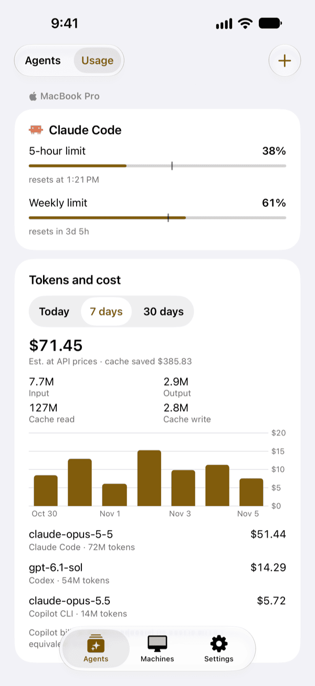
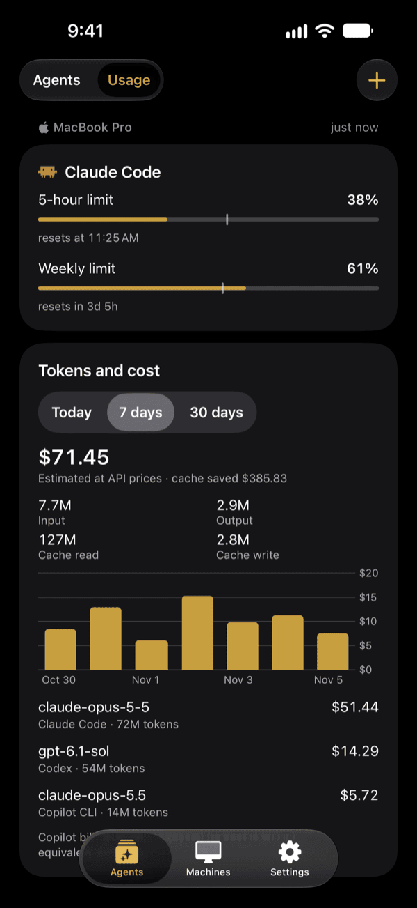
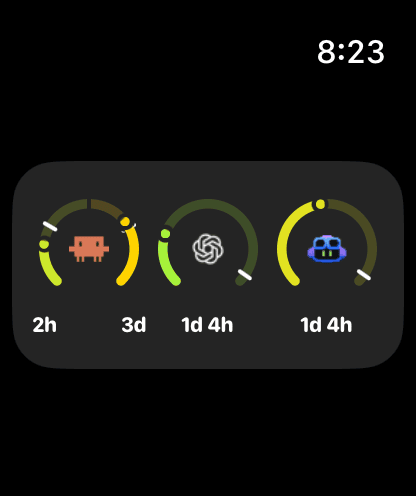

# Usage

To see plan usage and token cost, switch the Agents tab to **Usage**, or swipe left. For each machine, one card shows its plan usage and a second its tokens and cost. When you pair more than one machine, each machine's name heads its cards, and once none of its readings is current, the name also says how long ago the machine last recorded usage, or that it has recorded none. With one machine, the cards show without its name, and a machine that has recorded no usage says so above them.

| Agent | Plan usage | Source |
|---|---|---|
| Claude Code | 5-hour and weekly limits | The [status line tap](../install/claude-code.md#plan-usage) |
| Codex | Monthly credits and reset date, for a credit-metered workspace | The local [Codex](../agents/codex.md#plan-usage) app-server |
| Copilot | Monthly premium usage and reset date, or "Unlimited" | GitHub, with the machine's `gh` login ([Copilot CLI](../agents/copilot.md#plan-usage)) |

Each limit leads with its figure, then a bar and its reset time. The bar turns orange once you use 80% of the limit and red at 90%. A tick on each bar marks the time elapsed in its window: usage past the tick means you are using the plan faster than an even pace. A reading that is no longer current says when it was updated, such as "Updated 3h ago". The [Apple Watch](../notifications/apple-watch.md) complication and widget show the same readings.

## Tokens and cost

The **Tokens and cost** card, below the plan usage, shows the tokens all of the machine's agents used **Today** or over **7 days** or **30 days**, and their cost at API prices, by token type and by model. Over 7 or 30 days a chart shows the cost of each day: tap a bar to read that day's cost, and tap it again to clear it.

`collied` counts tokens in the machine's Claude Code, Codex and Copilot CLI transcripts, subagents included. Days end at midnight where your phone is.

Under the total, **Est. at API prices** says how it was priced. While `collied` is still counting, it reads **Partial est.** and the total grows as it goes. The cost is an estimate, not your bill: a subscription charges differently, and Copilot bills premium requests. Prices come from LiteLLM's price table, as shipped with `collied`. [Update collied](../operate/updating.md#collied) for newer prices, or when the card asks because the machine's release is too old to count tokens.
