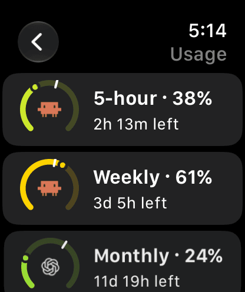

# Apple Watch

CollieWatch shows your pending approvals, agents and plan usage on your wrist. It installs with the iPhone app, holds no keys and never talks to `collied`: everything goes through the iPhone, even while it is locked (after its first unlock).

## In the watch app

- **Plan usage**: each window's percentage and reset countdown.
- **Approvals**: each pending approval with a countdown; open one to see its command.
- **Working** and **Done**: your agents as the iPhone last saw them, like the Inbox.

When the watch app opens, it asks the iPhone for fresh approvals, at most once a minute unless an approval alert opened it.

## Deciding from the watch

The watch shows approvals read-only until you turn on **Settings > Apple Watch > Decide from Apple Watch** on the iPhone, which asks for Face ID or the passcode. Then:

- the watch must be unlocked and on your wrist;
- you decide in the watch app, never from the alert itself;
- you can approve, deny or pick a menu option, but never Approve always.

For each decision, the iPhone checks the setting again and sends only an answer it showed the watch.

## Complication and widget

- The **circular complication** has four rings, outer to inner: Claude 5-hour, Claude weekly, Codex monthly and Copilot monthly premium usage. A ring's length shows the percentage used, and its color moves from green through yellow, orange and red as usage grows. A white tick marks how much of each window has passed.
- The **Plan usage widget**, in the Smart Stack or as a rectangular complication, shows a gauge for each provider with its logo and reset countdown. The Claude gauge splits in two: the 5-hour window on the left and the weekly window on the right, each with its own countdown. A small orange dot marks readings at least 30 minutes old.

An unlimited Copilot seat shows an empty ring and "Unlimited". Without a reading, a gauge shows "No data" and a ring stays dim.

Tap either one to open a compact usage list. Both refresh about every 15 minutes, when watchOS allows it.

### Choosing the agents

Each widget and complication shows Claude Code, Codex and Copilot until you choose otherwise. To show fewer, edit the watch face or Smart Stack on the watch, or the watch face in the iPhone's Watch app, and turn agents off in the widget's options. Each widget keeps its own choice. The Plan usage widget then shows same-size, centered gauges for the chosen agents, and the circular complication their rings, two for Claude Code. Turning all three off shows all three.
