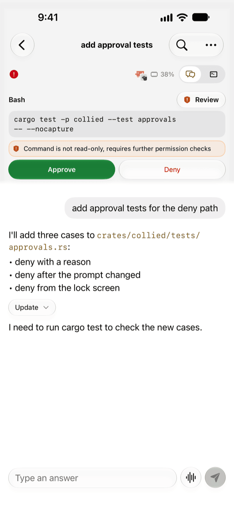
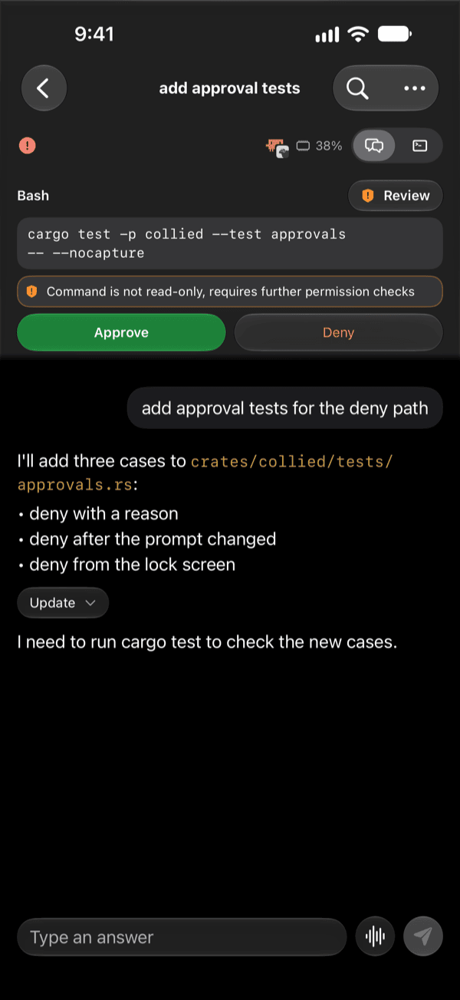

# Approvals and alerts

These alerts need [push notifications](../install/push.md).

## Approval alerts

A blocked agent's notification names the tool call as its prompt on screen shows it. For a Claude Code command, the command comes first and Claude's description after it; for a file or a web request, the file or address comes first, then the change. Tap it to open the session.

For Claude Code, choose **Approve** or **Deny** on the notification once the iPhone is unlocked, or in the app with Face ID or the passcode for each decision. If the prompt has changed by then, `collied` sends nothing. When Claude Code says why it asks, even in auto or bypass mode, the notification and the approval card show that reason.

Codex and Copilot CLI notifications have no Approve or Deny: answer in the session. A Codex notification previews the pending question, the action or the agent's latest response.

Once the agent moves on, `collied` tries to remove the notification.

The card shows the tool, its command as the notification shows it and **Review**, with a shield when the agent gave a reason. In the approval's last 2 minutes a countdown shows beside **Review**, red in the last minute. In landscape and with larger text, the card narrows to a band: the tool, a line of its command, **Review** and, when they fit, the buttons. **Review** opens the sheet, with the task (and its machine when you pair more than one), the whole command, the reason and the output, and **Add note** with the buttons. At half height the sheet is as tall as what it shows: the output, the command when the card above cuts it, and the reason when the card leaves it out. The card and the session header show the rest. Drag it up to see everything. To send a note with your decision, tap **Review**, then **Add note**, and type it. If a decision fails, for example when Face ID does not confirm it, a warning under that task's card, and in its sheet above the buttons, says so until your next decision or until the approval ends, even while other approvals arrive or leave. Other tasks never show it.

## Answering by hand

You can also answer any agent's prompt with the terminal buttons or the composer. This needs no Face ID and is not tied to one approval: if the prompt changes, the new prompt gets your input.

## Done alerts

When an agent finishes a turn of 30 seconds or more, you get one alert with its name and workspace, unless the agent is on screen. **Settings > Notifications > Notify when an agent finishes** turns these off, and [pull request](../app/pull-requests.md) alerts too.

On a Mac, collied also skips the alert when you sit in front of that agent: herdr saw the turn end (its tab was showing and the terminal had not lost focus), its pane is the focused one, the window in front belongs to the app that shows herdr (a terminal running it, or Herdr.app), and you typed or moved the pointer in the last 30 seconds, with the screen unlocked and awake. Away from the desk, behind a locked screen, in another tab or window, or with another app in front, you get the alert as before. A terminal that does not tell herdr when its tab or window loses focus can still have the alert skipped while another of its tabs or windows shows. Herdr Core and Rex agents, and agents on Linux, always alert, since collied cannot tell what their windows show. collied reads this on the Mac only when a turn ends, keeps nothing and sends nothing of it, and asks for no permission. Since herdr saw the turn, the app shows that agent as idle rather than done.

## What Apple can see

Only your phone can read alert text, names, pull request details and commands; Apple sees generic text and the metadata the [threat model](../reference/threat-model.md#apple-sees-push-payload-metadata) lists. If the phone cannot decrypt an alert in time, it shows generic text without approval controls.
