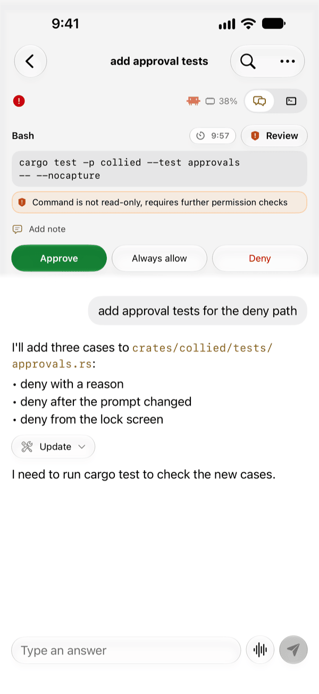
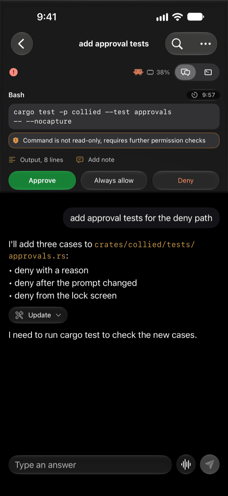

# Approvals and alerts

These alerts need [push notifications](../install/push.md).

## Approval alerts

A blocked agent's notification names the tool call: the exact command or file with the [Claude Code hook](../install/claude-code.md#the-permissionrequest-hook), otherwise what `collied` read from the screen. Tap it to open the session.

For Claude Code, choose **Approve** or **Deny** on the notification once the iPhone is unlocked, or in the app with Face ID or the passcode for each decision. If the prompt has changed by then, `collied` sends nothing. When Claude Code says why it asks, even in auto or bypass mode, the notification and the approval card show that reason.

Codex and Copilot CLI notifications have no Approve or Deny: answer in the session. A Codex notification previews the pending question, the action or the agent's latest response.

Once the agent moves on, `collied` tries to remove the notification.

The card leaves the command's output to a sheet: tap **Output** to read it. In landscape and with larger text, the card narrows to a band: the tool, a line of its command, **Review** and, when they fit, the buttons. **Review** opens the whole prompt in a sheet, with the task and its machine, the command, the reason, the output, **Add note** and the buttons; so do **Output**, the tool's name and **Show full command** on the full card. If a decision fails, for example when Face ID does not confirm it, a warning under the card, and in the sheet above the buttons, says so until your next decision or until the approval ends.

## Answering by hand

You can also answer any agent's prompt with the terminal buttons or the composer. This needs no Face ID and is not tied to one approval: if the prompt changes, the new prompt gets your input.

## Done alerts

When an agent finishes a turn of 30 seconds or more, you get one alert with its name and workspace, unless the agent is on screen. **Settings > Notifications > Notify when an agent finishes** turns these off, and [pull request](../app/pull-requests.md) alerts too.

## What Apple can see

Only your phone can read alert text, names, pull request details and commands; Apple sees generic text and the metadata the [threat model](../reference/threat-model.md#apple-sees-push-payload-metadata) lists. If the phone cannot decrypt an alert in time, it shows generic text without approval controls.
